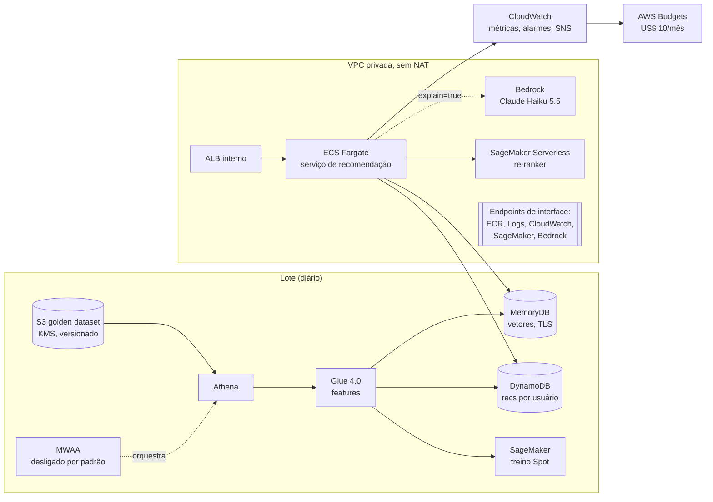

# Unidade 01.03 · Plataforma híbrida de recomendação na AWS

Projeto da unidade "Sistemas de recomendação" da disciplina 01 (Fundamentos de IA e LLMs). Uma loja virtual fictícia, com dados sintéticos, recebe recomendações que combinam um modelo em lote (histórico de compras) com busca vetorial em tempo real (o que o cliente está vendo agora), re-ranking por um modelo no SageMaker e, opcionalmente, uma frase por item explicando o motivo, gerada com Claude no Amazon Bedrock.

A arquitetura é **inspirada** no post "Building a scalable personalized recommendation system on AWS: From batch to real-time" do AWS Big Data Blog ([link](https://aws.amazon.com/blogs/big-data/building-a-scalable-personalized-recommendation-system-on-aws-from-batch-to-real-time/), lido em 2026-11-19), em que um time da Amazon.com descreve a sua arquitetura batch-first com Lake Formation, MWAA, Athena, Glue, SageMaker e DynamoDB, depois estendida com MemoryDB para busca vetorial. Este projeto **não** é esse sistema nem afirma reproduzi-lo: é um lab com dados sintéticos e escala mínima, e tudo o que vai além do post (endpoints, re-ranker serverless, explicação com Claude, testes) é decisão própria, registrada nos ADRs.

## Arquitetura



Fluxo de uma requisição: o serviço busca em paralelo os candidatos do lote (DynamoDB) e da busca vetorial (MemoryDB), junta e deduplica, aplica as regras de negócio (sem item fora de estoque nem comprado nos últimos 30 dias), pede o score ao SageMaker e devolve o top-N. Cada dependência tem fallback (heurística, só lote, só tempo real ou catálogo curado), e a API não responde 500 por falha de dependência.

Com `explain=true`, o serviço pede ao Claude uma frase por item, por saída estruturada via tool_use, valida (ids, tamanho, sinais com lastro nos dados, nada de preço ou desconto), tenta de novo uma vez devolvendo o erro ao modelo e, se ainda falhar, responde as mesmas recomendações sem explicação. Detalhes no [ADR-0004](adr/0004-explicacao-com-claude-no-bedrock.md).

## Decisões (ADRs)

| ADR | Decisão |
|---|---|
| [0001](adr/0001-state-remoto-com-lock.md) | State remoto em S3 com lock nativo (`use_lockfile`) e stack de bootstrap |
| [0002](adr/0002-saida-de-rede-e-custo-fixo.md) | Saída das tasks por endpoints de interface em 1 AZ no lab; inventário do custo fixo |
| [0003](adr/0003-seguranca-em-transito-e-menor-privilegio.md) | TLS no MemoryDB, ALB interno por padrão, IAM escopado, exceções do checkov |
| [0004](adr/0004-explicacao-com-claude-no-bedrock.md) | Explicação com Claude no Bedrock: tool_use, validação, retentativa e fallback |
| [0005](adr/0005-pipeline-ci-cd-com-oidc.md) | CI/CD com OIDC, plan no PR, apply e destroy em ambiente protegido |
| [0006](adr/0006-integracao-no-floci-e-lacunas.md) | Integração no Floci e lacunas do emulador |

## Custo (lab, us-east-1)

| Postura | Custo |
|---|---|
| Stack de pé (padrão do lab) | ~US$ 0,16/h: endpoints de interface, ALB, MemoryDB, 1 task Fargate, KMS |
| 20 h de lab por mês | ~US$ 3,20 + centavos de armazenamento e chamadas |
| Esquecido ligado 24/7 | ~US$ 115/mês (o alerta de 80% do orçamento dispara em ~2 dias) |
| Com MWAA ligado | +~US$ 0,49/h |
| Explicações com Claude | ~US$ 0,00035 por requisição com `explain=true` (tabela da API da Anthropic; o Bedrock tem tabela própria) |

**Teto mensal: US$ 10** no AWS Budgets, com alertas em 80% (real) e 100% (previsto) no tópico SNS de alertas. Valores aproximados de preços públicos de 2026-11; confira as páginas de preço antes do apply.

## Pré-requisitos

- Terraform >= 1.10 (testado com 1.13.4), Node.js 20, Python 3.11+, Docker.
- Para a AWS: conta de lab dedicada, acesso ao modelo Claude Haiku 5.5 habilitado no Bedrock na região, e permissão para criar o bucket de state.
- Para testar sem AWS: o emulador [Floci](https://floci.io) (`docker run -d -p 4566:4566 -v /var/run/docker.sock:/var/run/docker.sock floci/floci:latest`; o socket é necessário para o ECR do emulador).

## Como subir (5 passos)

1. Testes locais, sem nuvem: `npm ci && npm test && (cd infra/terraform && terraform init -backend=false && terraform test)`.
2. State remoto, uma vez por conta: `cd infra/bootstrap && terraform init && terraform apply -var github_repository=owner/repo`.
3. Configuração: copie `infra/terraform/backend.hcl.example` para `backend.hcl` e `terraform.tfvars.example` para `terraform.tfvars`, com o bucket do passo 2 e o seu e-mail de alerta.
4. Deploy: rode o workflow `01.03 recomendação · apply` (ambiente protegido `aws-lab`) ou, localmente, `terraform init -backend-config=backend.hcl && terraform apply`. Publique a imagem do serviço no repositório ECR da saída `ecr_repository_url` com a tag `lab`.
5. Destroy ao terminar: workflow `01.03 recomendação · destroy`, digitando `recsys-lab`. Ele falha se sobrar recurso com a tag `project`.

## Testes

| Camada | Comando | O que cobre |
|---|---|---|
| Regras da infra | `cd infra/terraform && terraform test` | 19 runs com mock provider: R1 a R9 por módulo ([matriz](docs/matriz-cobertura.md)) |
| Regras estruturais | `python3 infra/terraform/tests/static_rules.py` | Custo fixo citado em ADR, backend S3 com `use_lockfile` |
| Lint e segurança | `tflint --recursive`, `checkov -d infra` | 0 falhas; exceções justificadas inline |
| Serviço | `npm test` | 39 testes: fluxo híbrido, 5 modos de degradação, filtros e explicação com Claude |
| Lote | `python -m unittest discover -s tests` | 14 testes: DAG, transformações do Glue, contratos |
| Integração | `python3 testing/scripts/integracao_01_03_recomendacao.py` (raiz do repo) | apply, asserts, componente com Claude e destroy contra o Floci; relatório em `testing/reports/` |

## API

`GET /v1/recommendations?userId=u-12345&limit=10[&category=...][&sessionItemIds=A,B][&explain=true]`

```json
{
  "requestId": "req-9876543210",
  "userId": "u-12345",
  "degradedMode": false,
  "executionDurationMs": 42,
  "explanation": { "status": "ok", "modelId": "anthropic.claude-haiku-5-5", "attempts": 1 },
  "recommendations": [
    {
      "itemId": "SKU-9021",
      "rank": 1,
      "score": 0.945,
      "provenance": "hybrid",
      "title": "Fone de ouvido sem fio",
      "priceCents": 19999,
      "category": "Audio",
      "explanation": {
        "reason": "Combina com as suas compras anteriores e com itens parecidos de que você gostou.",
        "signals": ["purchase_history", "similar_items"],
        "source": "claude"
      }
    }
  ]
}
```

Sem `explain=true`, `explanation.status` é `not_requested` e o fluxo segue o SLO de p95 < 60 ms. Contrato completo em [`specs/.../recommendations-api.yaml`](specs/001-aws-recommendation-platform/contracts/recommendations-api.yaml).

## Estrutura

```text
src/serving/      serviço Node.js 20 / TypeScript (arquitetura hexagonal)
src/batch/        Athena, Glue, SageMaker e DAG do Airflow (Python)
infra/bootstrap/  bucket de state e roles OIDC do GitHub
infra/terraform/  stack principal: 14 módulos reutilizáveis e tests/
tests/            unitários, contrato e integração do serviço e do lote
adr/              decisões de arquitetura
posts/            post da arquitetura AWS e da comparativa em GCP
```
