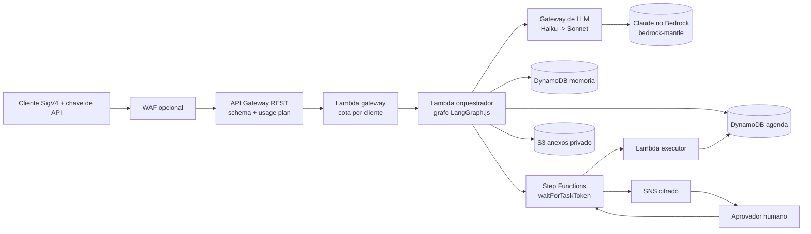

# Assistente de agendamento com Claude no Bedrock: o modelo propõe, o código decide

> RASCUNHO. Itens marcados "a confirmar" dependem de verificação antes de publicar.

**Resumo.** Um assistente que marca, cancela e consulta consultas a partir de linguagem natural, sobre dados sintéticos, com Claude no Amazon Bedrock. O modelo só propõe uma intenção estruturada; um gate determinístico decide o que executa, e todo cancelamento passa por aprovação humana (Step Functions). A infraestrutura é Terraform, serverless e com custo ocioso próximo de zero (único custo fixo: uma chave KMS, cerca de US$ 1/mês; teto do lab US$ 5/mês).

## O problema

Agendar por texto parece trivial até o modelo ter poder de escrita. Três riscos dominam: o modelo errar um campo (data, id), alguém induzir o modelo a agir em nome de outra pessoa (injeção de prompt, direta ou escondida em anexo), e o custo e a disponibilidade do provedor de modelo virarem dependência invisível. A pergunta de arquitetura é: onde fica a fronteira entre o que é probabilístico e o que é garantido?

## A âncora: o que a Natera fez

A âncora é o post do AWS Machine Learning Blog, [Natera's intelligent appointment scheduling with Amazon Bedrock AgentCore](https://aws.amazon.com/blogs/machine-learning/nateras-intelligent-appointment-scheduling-with-amazon-bedrock-agentcore/) (data de publicação: a confirmar; a página lida não a exibia). Segundo o post, a Natera construiu um agente de voz para agendar coleta de sangue domiciliar e o tem em produção. Pontos que importam aqui:

- Migração de ECS para o AgentCore Runtime, com o estado de sessão saindo da memória do contêiner para o AgentCore Memory, indexado por ator.
- Ponte com dois WebSockets (telefonia de um lado, modelo de voz do outro), com o orquestrador no meio.
- Mascaramento de latência: uma frase curta gerada por um modelo rápido (Claude Haiku) durante chamadas lentas de tool.
- Confiança progressiva: sessão inicial identificada pelo hash SHA-256 do telefone; após verificação de identidade, sessão autenticada com o histórico transferido.
- Tools com dados pessoais só são expostas após a verificação e ficam restritas à sessão do paciente. Guardrails e escalonamento para humano em sinais de risco.
- Resultados informados pela Natera: 100% de acerto de tool em 500 simulações de ponta a ponta; latência percebida mediana de 6,8 s; custo abaixo de US$ 0,01 por chamada concluída; 4.744 chamadas em quatro semanas de produção. São números da empresa, medidos no ambiente dela; não os replico como resultado deste projeto.

O post não detalha, por exemplo, o desenho interno do orquestrador nem a política de falhas do modelo. O que escrevo sobre isso abaixo é decisão minha, não reconstrução da Natera.

### O que o projeto segue e o que muda

| Aspecto | Natera | Este projeto | Por quê |
|---|---|---|---|
| Canal | Voz (telefonia, 2 WebSockets) | Texto via API REST | Sem voz não há ponte nem filler; o foco é o contrato entre modelo e ação |
| Princípio de confiança | Tools sensíveis só após verificação | Usuário vem do canal autenticado (SigV4), nunca do modelo | Mesmo princípio, mais simples em texto |
| Compute e memória | AgentCore Runtime + Memory | Lambda + DynamoDB | O plano de dados do AgentCore não é testável no emulador Floci; fica como caminho de produção |
| Modelo | Um modelo (mais Haiku para filler) | Gateway próprio com cadeia Haiku -> Sonnet, fallback, circuit breaker | Disponibilidade e custo viram política testável |
| Humano | Escalonamento por sinais | Aprovação obrigatória do cancelamento via Step Functions | Ação destrutiva exige decisão humana, não heurística |

## A arquitetura

Componentes (Terraform, módulos reutilizáveis):

- **Borda:** API Gateway REST com autenticação SigV4 (`AWS_IAM`), chave de API com usage plan e cota diária, e validação do corpo por schema antes de qualquer Lambda. WAF existe como módulo opcional, desligado no lab por custo fixo.
- **Compute:** três Lambdas (gateway, orquestrador, executor), Node 22, arm64, fora de VPC (evita NAT, que é custo fixo), cada uma com role de menor privilégio.
- **Dados:** quatro tabelas DynamoDB sob demanda com CMK e PITR (agenda, memória, gateway, operações); S3 privado para anexos.
- **Aprovação:** Step Functions Standard com `waitForTaskToken`, notificação por SNS cifrado.
- **Operação:** alarmes CloudWatch, AWS Budgets e uma chave KMS.

## Decisões e trade-offs

**Gateway de LLM próprio.** Só ele tem permissão de invocar o modelo. Ele aplica cota por cliente (DynamoDB), cadeia de modelos (`anthropic.claude-haiku-5-5` e, em falha, `anthropic.claude-sonnet-5-5`, via endpoint bedrock-mantle e o cliente oficial), circuit breaker e um ledger de custo por chamada. Os erros saem estruturados (categoria e se são retentáveis), de modo que fallback e retentativa sejam decisões de código. Alternativa considerada: a [Guidance for Multi-Provider Generative AI Gateway on AWS](https://docs.aws.amazon.com/solutions/multi-provider-generative-ai-gateway-on-aws/) (data: a confirmar), que usa LiteLLM em ECS/EKS com ALB, ElastiCache e RDS. É mais completa, mas traz custo fixo (balanceador, contêineres, banco), incompatível com o teto do lab; no desenho de produção multi-time eu avaliaria adotá-la.

**Grafo em código, aprovação em Step Functions.** O fluxo de uma mensagem (carregar contexto, defender entrada, extrair intenção, decidir, agendar, solicitar aprovação ou responder, com nó de fallback e atualização de memória) é um grafo LangGraph.js dentro da Lambda: é rápido, testável com funções puras e dura segundos. Já a espera pelo humano pode durar horas ou dias, e aí o certo é um orquestrador durável: Step Functions com `waitForTaskToken` pausa sem custo de compute e deixa histórico de execução como trilha de auditoria. Isso é o mesmo princípio do [post do AWS Compute Blog sobre validar decisões multiagente](https://aws.amazon.com/blogs/compute/validating-multi-agent-decisions-with-step-functions-and-bedrock-agentcore/) (data: a confirmar): agentes propõem, código determinístico valida, e o callback pausa o caso para revisão humana. O post [Build durable AI agents with LangGraph and Amazon DynamoDB](https://aws.amazon.com/blogs/database/build-durable-ai-agents-with-langgraph-and-amazon-dynamodb) (data: a confirmar) descreve checkpoints do LangGraph em DynamoDB; aqui não usei o checkpointer, e sim memória própria, por precisar de TTL, proveniência e apagamento (veja abaixo). Trade-off: dois mecanismos de orquestração para entender e operar.

**Intenção como proposta, gate como decisão.** O modelo devolve a intenção por `tool_use` com JSON Schema estrito e `tool_choice` auto, com exemplos (few-shot). A resposta passa por validação estrutural e semântica: data válida, ids conhecidos e evidência literal de cada campo na mensagem de origem. Se falha, o erro volta ao modelo como `tool_result` com `is_error` para uma retentativa limitada. Em seguida, o gate (`dominio/gate.ts`) decide: o usuário vem do canal autenticado, nunca do modelo; dado que só aparece em anexo não dispara ação; cancelamento sempre exige aprovação humana. O ganho é que a garantia de segurança não depende de o modelo se comportar. Custo: mais código e mais casos negativos para testar. O mesmo espírito aparece no post da AWS sobre [human-in-the-loop com Bedrock Agents](https://aws.amazon.com/blogs/machine-learning/implement-human-in-the-loop-confirmation-with-amazon-bedrock-agents/) (data: a confirmar), que trata ações sensíveis com confirmação do usuário.

**Memória em DynamoDB.** Turnos com TTL, fatos fixados pelo código (não pelo modelo), preferências com proveniência, resumo do histórico e direito de apagar. É a escolha serverless com custo ocioso zero; bancos relacionais locais seriam mais simples de iniciar, mas viram servidor para operar. Uma guarda impede que conteúdo suspeito entre na memória e contamine turnos futuros.

**Defesa em camadas, medida.** Normalização de texto, detector heurístico, envelope de dados não confiáveis com nonce, confinamento de caminho dos anexos, guarda da memória e verificação de saída com canário. As respostas ao paciente saem por template: o texto do modelo nunca vai direto ao usuário. A [orientação da AWS sobre injeção de prompt](https://aws.amazon.com/blogs/security/safeguard-your-generative-ai-workloads-from-prompt-injections) (atualizada em 23/01/2025, segundo a própria página) recomenda defesa em profundidade; o que o projeto acrescenta é medir. A bateria red team tem 24 ataques, executados no pior caso, em que o modelo obedece ao atacante: 0 tiveram efeito e 10 foram barrados já na entrada; 6 controles legítimos passaram sem falso positivo. Leitura honesta: os 14 ataques restantes só não têm efeito porque o gate e os templates limitam o que "obedecer" consegue fazer. Esse é o ponto da arquitetura.

**Respostas gravadas, e o que fica sem validação.** Os 142 testes de aplicação do componente Claude usam respostas gravadas, escritas à mão no formato da API. Elas provam contrato, validação, retentativa, fallback e gate. Elas não provam como o modelo real se comporta: acerto de extração, taxa de retentativa e robustez a ataques reais seguem sem validação. Avaliação e observabilidade de LLM estão em construção: Langfuse só local (Docker Compose) para o laboratório, mais um gate de avaliação no CI; na AWS ficam CloudWatch (EMF) e X-Ray.

## Segurança e FinOps

- Nada público por padrão; criptografia em repouso com CMK e em trânsito; tags `project`, `module`, `managed-by` em todos os recursos; IAM de menor privilégio por função.
- Lambdas fora de VPC para dispensar NAT Gateway; DynamoDB sob demanda; WAF opcional (custo fixo, ligar só quando justificar por ADR).
- Custo: KMS (cerca de US$ 1/mês) é o único custo fixo; teto do lab de US$ 5/mês com alerta no AWS Budgets. O custo por chamada de modelo é de centavos por uso de lab; valores exatos: a confirmar na página de preços do Bedrock. Os US$ 0,01 por chamada da Natera não se transferem: o fluxo, o modelo e o canal são outros.

## O que um time faria em produção

- Mover o orquestrador e a memória para AgentCore Runtime e Memory, como a Natera, ganhando isolamento por sessão e traces por etapa (o post mostra que 70% da latência percebida vinha de uma API de fornecedor, não do modelo: instrumente cada tool).
- Adicionar Bedrock Guardrails (filtros de ataque e de saída) em complemento às camadas próprias, não em substituição.
- Ligar o WAF e revisar cotas; avaliar a Guidance de gateway multi-provedor se houver vários times.
- Avaliar com o modelo real: conjunto dourado de extração, red team contra o modelo de verdade, e o gate de avaliação no CI como bloqueio.
- Revisar conformidade (a Natera cita HIPAA e BAA); aqui só há dados sintéticos e isso não foi avaliado.

## Fontes

- Natera / AWS Machine Learning Blog, "Natera's intelligent appointment scheduling with Amazon Bedrock AgentCore": https://aws.amazon.com/blogs/machine-learning/nateras-intelligent-appointment-scheduling-with-amazon-bedrock-agentcore/ (data: a confirmar; lida em 19/11/2026)
- Guidance for Multi-Provider Generative AI Gateway on AWS: https://docs.aws.amazon.com/solutions/multi-provider-generative-ai-gateway-on-aws/ (data: a confirmar; lida em 19/11/2026)
- AWS Compute Blog, Validating multi-agent decisions with Step Functions and Bedrock AgentCore: https://aws.amazon.com/blogs/compute/validating-multi-agent-decisions-with-step-functions-and-bedrock-agentcore/ (data: a confirmar)
- AWS Database Blog, Build durable AI agents with LangGraph and Amazon DynamoDB: https://aws.amazon.com/blogs/database/build-durable-ai-agents-with-langgraph-and-amazon-dynamodb (data: a confirmar)
- AWS Security Blog, Safeguard your generative AI workloads from prompt injections: https://aws.amazon.com/blogs/security/safeguard-your-generative-ai-workloads-from-prompt-injections (atualizado em 23/01/2025)
- AWS Machine Learning Blog, Implement human-in-the-loop confirmation with Amazon Bedrock Agents: https://aws.amazon.com/blogs/machine-learning/implement-human-in-the-loop-confirmation-with-amazon-bedrock-agents/ (data: a confirmar)
- Preços do Bedrock: a confirmar.
