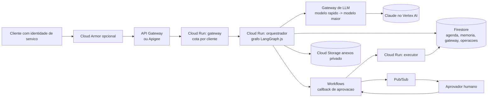

# Assistente de agendamento no Google Cloud: design doc

> RASCUNHO. Design doc, não implementado. A documentação do Google (cloud.google.com) não pôde ser acessada durante a escrita (host fora da rede permitida da sessão); por isso todo nome, capacidade e limite de serviço do Google abaixo está marcado "a confirmar" e vem de conhecimento prévio, não de fonte verificada. Antes de publicar, confirmar cada linha e preencher as datas.

## Objetivo

Reproduzir, o mais igual possível, a arquitetura do [post da AWS](aws.md): assistente de agendamento por linguagem natural (marcar, cancelar, consultar), dados sintéticos, em que o modelo só propõe uma intenção estruturada e um gate determinístico decide. A âncora de referência é o caso da Natera com Amazon Bedrock AgentCore ([AWS Machine Learning Blog](https://aws.amazon.com/blogs/machine-learning/nateras-intelligent-appointment-scheduling-with-amazon-bedrock-agentcore/), data: a confirmar); o equivalente do AgentCore no Google fica como caminho de produção, e o de lab usa serviços serverless simples.

## Diagrama

## Mapeamento serviço a serviço

| AWS | Google Cloud | Equivalente direto? | O que muda e por quê |
|---|---|---|---|
| API Gateway REST (SigV4, chave de API, usage plan, validação de schema) | API Gateway ou Apigee (a confirmar) | Parcial | Autenticação por identidade de serviço/JWT em vez de SigV4. Cota por cliente e validação de corpo por schema são nativas em Apigee (políticas); no API Gateway básico, a validação e a cota fina provavelmente migram para o próprio gateway de LLM. Apigee tem custo ocioso maior (a confirmar), então no lab o padrão é API Gateway |
| WAF (opcional) | Cloud Armor | Sim, em conceito | Também tem custo fixo; segue opcional e desligado no lab (a confirmar preço) |
| Lambda (3 funções, Node 22, arm64) | Cloud Run (serviços) ou Cloud Run functions | Sim | Contêiner em vez de pacote zip; arm64 depende de suporte da região (a confirmar). Escala a zero, preservando o custo ocioso nulo. Cada serviço com service account própria (menor privilégio) |
| DynamoDB (4 tabelas, sob demanda, CMK, PITR, TTL) | Firestore (modo nativo) | Parcial | Modelo de documentos com coleções em vez de chave/valor; TTL por política de campo (a confirmar); recuperação pontual existe, mas o recurso e a retenção diferem (a confirmar). Contadores de cota e circuit breaker passam a usar transações do Firestore em vez de atualizações condicionais do DynamoDB |
| Step Functions Standard com `waitForTaskToken` | Workflows com callbacks | Parcial | Workflows suporta criar um endpoint de callback e aguardar a chamada (a confirmar na página de callbacks). O token vira uma URL de callback; é preciso proteger essa URL com autenticação da aprovação e definir o timeout. O histórico de execução serve de auditoria, mas o formato difere (a confirmar) |
| SNS (cifrado) | Pub/Sub | Sim | Tópico com chave gerenciada pelo cliente (CMEK) (a confirmar) |
| S3 (privado, cifrado) | Cloud Storage | Sim | Acesso uniforme no nível do bucket e bloqueio de acesso público (a confirmar o nome exato das configurações) |
| KMS (CMK, ~US$ 1/mês) | Cloud KMS | Sim | Modelo de custo por versão de chave e por operação difere (a confirmar); o custo fixo do lab pode não ser idêntico |
| CloudWatch (alarmes, EMF) e X-Ray | Cloud Logging, Cloud Monitoring (alertas, métricas baseadas em log) e Cloud Trace | Sim, em conceito | Sem o formato EMF; métricas customizadas vêm de OpenTelemetry ou de métricas baseadas em log (a confirmar) |
| AWS Budgets (teto US$ 5/mês) | Cloud Billing budgets | Sim | Alerta, não bloqueio, nos dois casos (a confirmar para o Google). Mesmo teto de lab como meta |
| IAM, roles por Lambda | IAM, service accounts por serviço | Sim | Mesmo princípio; papéis predefinidos podem ser amplos, então preferir papéis customizados |
| Claude no Bedrock (endpoint bedrock-mantle) | Claude no Vertex AI | Sim, com ressalvas | A disponibilidade de modelos e versões por região no Vertex AI precisa ser confirmada; os identificadores `anthropic.claude-haiku-5-5` e `anthropic.claude-sonnet-5-5` não são os mesmos no Vertex AI (nomes a confirmar). O SDK e o cliente mudam; o contrato de tool use e schema estrito é o mesmo conceito, mas a compatibilidade exata dos parâmetros deve ser verificada (a confirmar) |
| AgentCore Runtime e Memory (produção) | Vertex AI Agent Engine (a confirmar) | Sem equivalente direto confirmado | Não verifiquei a paridade de sessões, memória por ator e isolamento por microVM; trate como a confirmar, e como decisão de produção, não de lab |

## O que não muda

O núcleo é código portátil: o grafo LangGraph.js, a validação estrutural e semântica da intenção, o gate determinístico (usuário vem do canal autenticado, anexos não disparam ação, cancelamento sempre com aprovação humana), a memória com proveniência e as defesas em camadas com respostas por template. A bateria de 24 ataques (0 com efeito, 10 barrados na entrada, 6 controles sem falso positivo) e os 142 testes de aplicação rodam sobre esse núcleo, não sobre a cloud, e se aplicariam sem alteração; os testes de infraestrutura seriam reescritos.

## Onde a migração dói

1. **Callback de aprovação:** a semântica de token da AWS (opaco, entregue por `SendTaskSuccess`) vira URL de callback. A superfície de ataque muda: a URL precisa ser tratada como segredo e autenticada.
2. **Firestore no lugar de DynamoDB:** consistência, transações e custo por leitura diferem; o ledger de custo e o circuit breaker precisam ser retestados.
3. **Gateway de borda:** se a cota e a validação de schema não estiverem no gateway escolhido, o gateway de LLM absorve essas regras.
4. **Modelo:** versões e ids do Claude no Vertex AI, e a região, devem ser confirmados antes de definir a cadeia de fallback.

## Custo e validação

Mesmo teto de lab como meta (US$ 5/mês), com Cloud Run escalando a zero e Firestore sob demanda. Custos fixos prováveis: Cloud KMS e, se ligados, Cloud Armor e Apigee; valores a confirmar nas páginas de preço do Google. Este design doc não foi implementado nem aplicado; implementar só se for barato validar.

## Fontes

Nenhuma página do Google pôde ser lida nesta sessão; as datas e URLs oficiais devem ser inseridas na revisão. Páginas a consultar (cloud.google.com): Workflows (callbacks), Vertex AI (modelos parceiros da Anthropic), API Gateway, Apigee, Cloud Run, Firestore (TTL, recuperação pontual), Cloud KMS, Cloud Armor, Cloud Billing budgets.

- Natera / AWS Machine Learning Blog (âncora): https://aws.amazon.com/blogs/machine-learning/nateras-intelligent-appointment-scheduling-with-amazon-bedrock-agentcore/ (data: a confirmar; lida em 19/11/2026)
- Post da arquitetura AWS deste projeto: [aws.md](aws.md)
