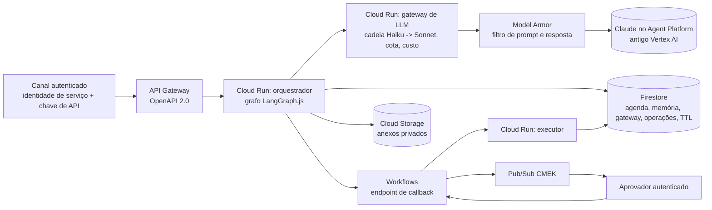

# Cloud comparativa (GCP): design doc do assistente de agendamento

- **Cloud:** Google Cloud, escolha do dono (D-007). Não implementado; implementar só se for barato validar e com a aprovação do dono.
- **Data das consultas:** 2026-11-21, todas nas páginas oficiais de `cloud.google.com` listadas em "Fontes". Esta versão substitui o rascunho de `posts/gcp.md`, escrito quando a documentação do Google estava fora da rede da sessão e marcado inteiro "a confirmar".
- **Onde fica:** aqui, em `specs/`, porque o gate SDD bloqueia a pasta do projeto antes da fase implementar. Na implementação ele vai para `modulos/02-apis-ia-generativa/arquitetura/docs/gcp.md`, e o post `posts/gcp.md` é refeito a partir dele na fase publicar.
- **Base:** a arquitetura do `plan.md` (AWS), com o núcleo portátil (grafo, intenção, gate, memória, defesas e respostas por template) igual nas duas clouds.

## Diagrama

## Mapeamento serviço a serviço
| Componente | AWS | GCP | Equivalência | O que muda e por quê | Fonte oficial (consulta em 2026-11-21) |
|---|---|---|---|---|---|
| Borda | API Gateway REST (SigV4, chave de API, usage plan, validação por schema) | API Gateway | parcial | A API é definida em OpenAPI 2.0 e aceita chave de API e autenticação de identidade do Google; não há usage plan com cota por chave nem validação de corpo por schema equivalentes. A cota por cliente já existe no gateway de LLM, e a validação do corpo fica só no orquestrador (que hoje já valida de novo) | [About API Gateway](https://cloud.google.com/api-gateway/docs/about-api-gateway) |
| Filtro de borda (opcional) | AWS WAF (desligado no lab) | Cloud Armor | parcial | Continua desligado no lab; não consultado em detalhe porque não entra no desenho do lab (a confirmar) | a confirmar |
| Compute | 3 Lambdas Node 22 arm64, fora de VPC | 3 serviços Cloud Run | parcial | Contêiner em vez de zip. Cobrança por recurso usado, arredondada para 100 ms, com escala a zero, o que preserva o custo ocioso nulo. Uma conta de serviço por serviço, com papel mínimo | [Cloud Run pricing](https://cloud.google.com/run/pricing) |
| Acesso ao Claude | Bedrock `bedrock-runtime`, perfil de inferência por modelo, guardrail do produto | Claude no Gemini Enterprise Agent Platform (antigo Vertex AI): Haiku 5.5 e Sonnet 5.5 disponíveis | parcial | Habilitação do modelo por projeto pelo Cloud Marketplace; ids sem o prefixo `anthropic.`; cliente `AnthropicVertex`. Não há perfil de inferência de aplicação: a atribuição de custo vem do projeto e de rótulos, não de um recurso por produto | [Claude on Google Cloud](https://cloud.google.com/vertex-ai/generative-ai/docs/partner-models/claude) |
| Guardrail do modelo | Bedrock Guardrails (filtros de conteúdo, ataque de prompt, informação sensível) | Model Armor | parcial | Model Armor inspeciona o prompt antes do modelo e a resposta depois, como serviço separado chamado pelo gateway de LLM; não é um parâmetro da chamada ao modelo. Uma chamada a mais por turno | [Model Armor overview](https://cloud.google.com/security-command-center/docs/model-armor-overview) |
| Dados | 4 tabelas DynamoDB sob demanda, CMK, PITR, TTL | Firestore (modo nativo) | parcial | Documentos e coleções em vez de chave e ordenação. TTL por campo, com exclusão típica em até 24 horas depois do vencimento (a leitura continua filtrando `expira_em`). PITR com janela de 7 dias. Cota, circuito e ledger passam de escrita condicional para transação do Firestore e precisam ser retestados | [TTL](https://cloud.google.com/firestore/native/docs/ttl); [PITR](https://cloud.google.com/firestore/native/docs/use-pitr); [pricing](https://cloud.google.com/firestore/pricing) |
| Anexos | S3 privado, KMS, TLS obrigatório | Cloud Storage | direta | Acesso uniforme no bucket e bloqueio de acesso público; o confinamento `anexos/<usuario>/` continua no código (nomes de configuração a confirmar) | a confirmar |
| Aprovação humana | Step Functions Standard, `waitForTaskToken`, timeout de 24 h | Workflows com endpoint de callback | parcial | O token opaco vira uma URL de callback que a execução espera; o chamador precisa do papel de invocador do Workflows, então a aprovação continua autenticada por identidade (ADR-0004). O timeout padrão do callback é de 12 horas e é configurável; o de 24 h é explícito. Passo que espera callback é cobrado como passo externo | [Callbacks](https://cloud.google.com/workflows/docs/creating-callback-endpoints); [Workflows pricing](https://cloud.google.com/workflows/pricing) |
| Aviso ao aprovador | SNS cifrado | Pub/Sub com CMEK | direta | Tópico com chave do Cloud KMS | [Pub/Sub encryption](https://cloud.google.com/pubsub/docs/encryption) |
| Chave | KMS, chave do cliente, US$ 1/mês rateado por hora | Cloud KMS, chave `SOFTWARE` | direta | Cobrança por versão ativa de chave, US$ 0,000082192 por hora (cerca de US$ 0,002 por dia); versão destruída não é cobrada | [Cloud KMS pricing](https://cloud.google.com/kms/pricing) |
| Logs e métricas | CloudWatch (logs, EMF, alarmes) | Cloud Logging e Cloud Monitoring | parcial | Sem EMF: as métricas de negócio viram métricas baseadas em log ou OpenTelemetry; os 9 alarmes viram políticas de alerta (a confirmar) | a confirmar |
| Traces | X-Ray | Cloud Trace | parcial | Instrumentação por OpenTelemetry (a confirmar) | a confirmar |
| Segredo do Langfuse | SSM Parameter Store `SecureString` | Secret Manager | parcial | Serviço de segredos dedicado, cobrado por versão e acesso (a confirmar) | a confirmar |
| Tracing de LLM | Langfuse Cloud opcional (D-048) | igual | direta | Independe da cloud | D-048 |
| Orçamento | AWS Budgets **diário** | Cloud Billing budgets | parcial | O orçamento de alerta só tem período mensal, trimestral, anual ou personalizado; o "diário" vira um intervalo personalizado de um dia, refeito a cada demonstração. Alerta não bloqueia; existe orçamento com teto de gasto por projeto onde o serviço suporta | [Budgets](https://cloud.google.com/billing/docs/how-to/budgets) |
| Identidade e menor privilégio | IAM, uma role por Lambda, ABAC por tag | IAM, uma conta de serviço por serviço | direta | Papéis predefinidos podem ser amplos; preferir papéis personalizados (a confirmar) | a confirmar |
| Isolamento por projeto | conta única com tag `project` e prefixo (D-029) | um projeto do Google Cloud por produto | parcial | No GCP o isolamento natural é o projeto, e não a tag (a confirmar) | a confirmar |
| Plataforma compartilhada (opção A ou B do ADR-0003) | AgentCore Gateway, Policy, guardrail e perfil por produto | Agent Platform: Agent Runtime, Sessions e Memory Bank | sem equivalente direto confirmado | A página do Agent Platform descreve runtime gerenciado, sessões e memória de longo prazo; não verifiquei um gateway MCP com política Cedar equivalente. Fica como decisão de produção, não de lab | [Scale your agents](https://cloud.google.com/vertex-ai/generative-ai/docs/agent-engine/overview) |

## O que não muda
O núcleo é código portátil: o grafo, a validação estrutural e semântica da intenção, o gate (usuário do canal autenticado, anexo não dispara ação, cancelamento só com aprovação humana), a memória com proveniência, as defesas em camadas e as respostas por template. Os 149 testes da aplicação e a bateria red team rodam sobre esse núcleo e valeriam sem alteração; os testes de infraestrutura seriam reescritos.

## Onde a migração dói
1. **Callback de aprovação:** a URL de callback é endereçável e precisa de autenticação forte; o token da AWS só existe dentro do Step Functions.
2. **Firestore:** transações e custo por leitura diferentes; cota, circuito e ledger precisam de reteste.
3. **Guardrail como chamada separada:** Model Armor soma uma ida e volta por turno no gateway de LLM, em vez de um parâmetro da chamada ao modelo.
4. **Orçamento diário:** não existe como período; precisa de intervalo personalizado por demonstração.

## Custo e validação
Mesmo padrão do lab: escala a zero no Cloud Run, Firestore por operação, chave do Cloud KMS por hora. Os valores do Claude no Agent Platform e do Model Armor não foram lidos nesta consulta (as páginas de preço montam a tabela no navegador); antes de qualquer implementação, eles entram com fonte e data. Este documento não foi implementado nem aplicado.

## Fontes (consulta em 2026-11-21)
- API Gateway: https://cloud.google.com/api-gateway/docs/about-api-gateway
- Cloud Run, preços: https://cloud.google.com/run/pricing
- Claude no Google Cloud (Agent Platform): https://cloud.google.com/vertex-ai/generative-ai/docs/partner-models/claude
- Model Armor: https://cloud.google.com/security-command-center/docs/model-armor-overview
- Firestore, TTL: https://cloud.google.com/firestore/native/docs/ttl
- Firestore, PITR: https://cloud.google.com/firestore/native/docs/use-pitr
- Firestore, preços: https://cloud.google.com/firestore/pricing
- Workflows, callbacks: https://cloud.google.com/workflows/docs/creating-callback-endpoints
- Workflows, preços: https://cloud.google.com/workflows/pricing
- Pub/Sub, criptografia: https://cloud.google.com/pubsub/docs/encryption
- Cloud KMS, preços: https://cloud.google.com/kms/pricing
- Cloud Billing budgets: https://cloud.google.com/billing/docs/how-to/budgets
- Agent Platform, escalar agentes: https://cloud.google.com/vertex-ai/generative-ai/docs/agent-engine/overview
- Âncora AWS (Natera, 26/08/2026): https://aws.amazon.com/blogs/machine-learning/nateras-intelligent-appointment-scheduling-with-amazon-bedrock-agentcore/
