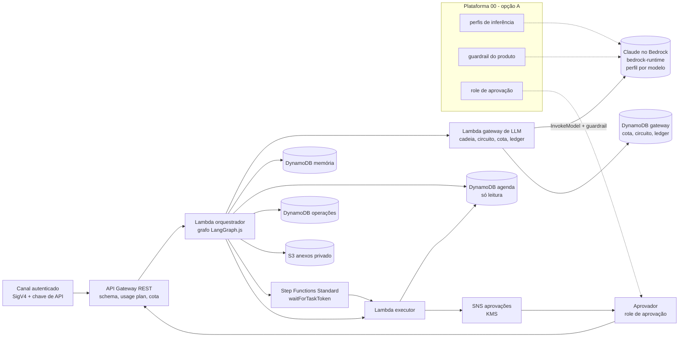

# Plano: Assistente de agendamento completo

- **Spec:** `specs/02-assistente-agendamento/spec.md` · **Status:** rascunho, pronto para a aprovação do dono (D-033). Nada aqui vale como aprovado
- **Data:** 2026-11-21 · **Autor:** arquiteto-aws (Claude Opus 5.5), em plan mode, sem chamada à AWS além da leitura pública da Price List
- **Decisões do dono aplicadas:** D-006, D-007, D-013, D-008, D-021, D-022, D-024, D-029, D-030, D-031, D-048, D-062, D-065, D-068
- **Decisões do dono (2026-11-22):** D02-P2 a D02-P4 decididas, e as divergências DV-01 a DV-12 também (seção "Decisões do dono" no fim). Falta só a aprovação deste plano (D02-P5)
- **ADRs:** `specs/02-assistente-agendamento/adr/`. O gate SDD bloqueia a pasta do projeto antes da fase implementar; a primeira tarefa de implementar os move para `modulos/02-apis-ia-generativa/arquitetura/adr/`, onde o código já os cita
- **Âncora (D-065):** *Natera's intelligent appointment scheduling with Amazon Bedrock AgentCore*, AWS Machine Learning Blog, 26/08/2026, lida na íntegra em 2026-11-21 (ADR-0001)

## Resumo
- **Plano retroativo.** O assistente já existe e tem 149 testes verdes. O plano mantém o núcleo (grafo, intenção com schema estrito, gate, memória, defesas, respostas por template, gate de avaliação e red team) e corrige o que diverge da constituição e das decisões em vigor (DV-01 a DV-11 da spec).
- **Mudanças de arquitetura:**
  1. acesso ao Claude pelo `bedrock-runtime`, com perfil de inferência de aplicação por modelo da cadeia e guardrail do produto, porque o `bedrock-mantle` não aceita nenhum dos dois para o Haiku 5.5 e o Sonnet 5.5 (ADR-0002);
  2. aprovação humana autenticada: a rota de aprovação só aceita a role de aprovação, e o aprovador é a identidade do chamador (ADR-0004);
  3. conta única: tag `project = 02-assistente-agendamento`, `module` em kebab, prefixo da chave, Budgets diário, apply e destroy pelos modelos do harness, sem bootstrap próprio (ADR-0007);
  4. CI do D02 com o gate de avaliação e tracing opcional no Langfuse Cloud (ADR-0006).
- **Plataforma:** o nível de consumo é decisão do dono (D02-P3). O plano recomenda a opção A (perfis, guardrail e role de aprovação pelo módulo `registro-produto`, sem alvo MCP) e marca o que muda em B e C.
- **Custo de um dia (só o stack do D02):** estimativa de **US$ 0,71**; pior caso limitado pela cota de tokens: US$ 2,16. **Teto diário: US$ 0,85, decidido pelo dono (D02-P4)**; gravado no `harness/estado.json` na aprovação do plano.

## Verificação da constituição
| Artigo | Como o plano cumpre | Risco |
|---|---|---|
| I · SDD | Spec retroativa esclarecida e este plano. `tasks.md` só depois da aprovação do plano (D-033). ADRs e design doc em `specs/` até a fase implementar | O código existe desde antes do SDD; as correções viram tarefas, com teste vermelho antes |
| II · Decisões do dono | Nenhuma escolha do dono assumida: consumo da plataforma (D02-P3), chaves do Langfuse (D02-P2) e teto (D02-P4) ficam pendentes. A D02-P1 foi dispensada pelo dono, sem decisão | Se D02-P3 sair diferente de A, mudam o ADR-0002 (de onde vêm perfil e guardrail) e a ordem do dia; a tabela de opções já mostra o efeito |
| III · Testes primeiro | 149 testes vitest e 35 blocos `terraform test` existentes; cada correção começa com teste vermelho (matriz abaixo); componente Claude só com respostas gravadas (D-006); Floci só com o projeto completo (ADR-0008) | O guardrail e o perfil não são emulados: prova em TT e DM |
| IV · Segurança por padrão | Nada público (SigV4, chave de API, política de recurso que nega outra conta, bucket privado com TLS obrigatório); KMS do cliente com rotação em tabelas, bucket, SNS, logs, variáveis e Step Functions; uma role por Lambda sem curinga de ação; invocação do modelo só nos ARNs dos perfis (corrige DV-07); aprovação por role (corrige DV-11); deploy pela role da conta, sem `PowerUserAccess` do projeto (corrige DV-06) | X-Ray exige `*` em recurso (exceção documentada no módulo) |
| V · Custo consciente | Sem NAT, endpoint de interface, cluster ou WAF no lab; Budgets diário com `var.teto_diario_usd` (corrige DV-04); cota de tokens como limite duro; apply com `prazo_horas` e destroy com `confirm_stack` a partir dos modelos (corrige DV-05); custo de 24 h com fonte abaixo | O valor do teto é do dono (D02-P4) |
| VI · Operável e replicável | Tags e prefixo da D-029 e da D-031 (corrige DV-01 a DV-03); 9 alarmes mais o de intervenção do guardrail; state remoto com `use_lockfile`; README com até 5 passos (corrige DV-10) | Renomear muda todos os nomes do plan e os testes do Terraform |
| VII · Lente da certificação | Componente Claude ligado a 1.4, 2.1, 2.2, 2.3, 4.1 a 4.4, 4.6, 5.1 a 5.3, 5.5 e 5.6 (spec); cada ADR traz os ids, o curso Skilljar e o que um sênior faria | nenhum |
| VIII · Proveniência e privacidade | Âncora e fontes com data; só dados sintéticos versionados; números da Natera citados só como da empresa | Dado real colado na demonstração: o roteiro lê só fixtures; a entrada das gerações vai mascarada ao Langfuse |

## Arquitetura

### Visão geral (opção A do ADR-0003, recomendada)

- **Ordem do dia (A ou B):** apply da plataforma; apply do D02 (registra perfis, guardrail e role de aprovação pelo módulo); roteiro, rodada real do gate e do red team, gravação; destroy do D02; destroy da plataforma (ADR-0007 da plataforma, prazo do produto pelo menos 1 h antes).
- **Opção C:** o mesmo diagrama, com perfis, guardrail e role de aprovação no stack do D02.

### Serviços
Fontes de preço: AWS Price List (arquivos públicos de oferta por serviço em `us-east-1`, publicados entre 2026-11-04 e 2026-11-20, lidos em 2026-11-21). Floci: [lista de serviços](https://floci.io/floci/services/), lida em 2026-11-21.

| Serviço | Papel | Por que este | Alternativa rejeitada | Fonte oficial da AWS | Floci |
|---|---|---|---|---|---|
| Amazon API Gateway (REST) | borda das três rotas, SigV4, chave de API com usage plan e cota diária, validação de corpo por schema | validação e cota antes de qualquer Lambda; `AWS_IAM` sem servidor de identidade | HTTP API: sem usage plan nem validação de corpo por modelo | [preços do API Gateway](https://aws.amazon.com/api-gateway/pricing/) | API Gateway v1 emulado |
| AWS Lambda (arm64, Node 22, fora de VPC) | orquestrador, gateway de LLM e executor | escala a zero, um turno dura segundos; fora de VPC evita NAT | AgentCore Runtime, como a âncora: plano de dados não emulado (ADR-0001) | [preços do Lambda](https://aws.amazon.com/lambda/pricing/) | emulado (contêiner real) |
| Amazon Bedrock (`bedrock-runtime`, Messages API) | Claude Haiku 5.5 e Claude Sonnet 5.5 pela cadeia do gateway | aceita guardrail e perfil de inferência de aplicação; o `bedrock-mantle` não (ADR-0002) | `bedrock-mantle` (código atual) | [ficha do Haiku 5.5](https://docs.aws.amazon.com/bedrock/latest/userguide/model-card-anthropic-claude-haiku-5-5.html); [ficha do Sonnet 5.5](https://docs.aws.amazon.com/bedrock/latest/userguide/model-card-anthropic-claude-sonnet-5-5.html); [preços](https://aws.amazon.com/bedrock/pricing/) | Bedrock Runtime emulado; no Floci o gateway roda `modo_llm = gravado` |
| Perfil de inferência de aplicação | um por modelo da cadeia, com a tag `project` | custo por produto e role limitada ao próprio perfil | uma conta por produto (fora, D-029) | [criar perfil](https://docs.aws.amazon.com/bedrock/latest/userguide/inference-profiles-create.html) | não documentado: TT e DM |
| Amazon Bedrock Guardrails | guardrail do produto em toda chamada, com o dado não confiável marcado | ataque de prompt na camada do modelo, além das camadas próprias | só as camadas próprias: sem defesa gerenciada medida | [componentes](https://docs.aws.amazon.com/bedrock/latest/userguide/guardrails-components.html) | fora de escopo no Floci: TT e DM |
| Amazon DynamoDB (sob demanda, KMS, PITR) | agenda, memória, gateway e operações | custo ocioso zero, escrita condicional e transações | Aurora Serverless ou RDS: servidor e custo mínimo | [preços do DynamoDB](https://aws.amazon.com/dynamodb/pricing/) | emulado |
| AWS Step Functions (Standard) | espera da aprovação humana com `waitForTaskToken` | pausa sem compute, timeout e histórico de execução (ADR-0004) | espera no grafo: turno aberto ou retomada própria | [preços do Step Functions](https://aws.amazon.com/step-functions/pricing/) | emulado |
| Amazon SNS (KMS) | aviso ao aprovador e alertas | cobrança por requisição | e-mail direto: o CloudWatch exige SNS para alarmes | [preços do SNS](https://aws.amazon.com/sns/pricing/) | emulado |
| Amazon S3 | anexos privados, versionados, TLS obrigatório, retenção de 30 dias | leitura confinada por prefixo do paciente | EFS: custo e rede | [preços do S3](https://aws.amazon.com/s3/pricing/) | emulado |
| AWS KMS | chave do cliente do stack, com rotação | o CloudWatch não publica em SNS cifrado com `aws/sns`; controle do uso por `kms:ViaService` | chave gerenciada pela AWS | [preços do KMS](https://aws.amazon.com/kms/pricing/) | emulado |
| Amazon CloudWatch (logs JSON, EMF, alarmes) | métricas de negócio do LLM sem `PutMetricData`; 9 alarmes | EMF sai no log, sem chamada de API | `PutMetricData`: uma chamada por métrica | [preços do CloudWatch](https://aws.amazon.com/cloudwatch/pricing/) | Logs e Metrics emulados |
| AWS X-Ray | traces das Lambdas e da API | ligado nas três Lambdas e no estágio | só logs: sem tempo por etapa | [preços do X-Ray](https://aws.amazon.com/xray/pricing/) | emulado |
| AWS Budgets | orçamento **diário** pela tag `project` | gratuito; avisa no dia | só o mensal da conta: avisa tarde | [preços do Budgets](https://aws.amazon.com/aws-cost-management/aws-budgets/pricing/) | emulado |
| AWS WAF (desligado) | módulo opcional | custo fixo sem ganho no lab | ligado no lab: web ACL e regras cobradas por mês | [preços do WAF](https://aws.amazon.com/waf/pricing/) | WAF v2 emulado |
| AWS Systems Manager Parameter Store (`SecureString`) | chaves do Langfuse Cloud, criadas pelo dono fora do Terraform (ADR-0006) | segredo fora do state, com `aws/ssm` e sem custo na camada padrão | Secrets Manager: cobrança por segredo por mês sem ganho no lab; variável de ambiente: segredo em texto claro | [Parameter Store](https://docs.aws.amazon.com/systems-manager/latest/userguide/systems-manager-parameter-store.html) | emulado (SSM) |
| IAM | uma role por Lambda, role de aprovação, role do Step Functions | sem custo | usuários com chave estática | [boas práticas do IAM](https://docs.aws.amazon.com/IAM/latest/UserGuide/best-practices.html) | emulado |

### O que muda no código e no Terraform (vira tarefa)
| Item | De | Para | Corrige |
|---|---|---|---|
| Provedor do Claude | `AnthropicBedrockMantle`, `bedrock-mantle:CreateInference` em `project/*` | `bedrock-runtime` com o ARN do perfil e o guardrail por chamada; permissão só nos perfis e modelos de origem | DV-07, E1, E2 |
| Cadeia de modelos | ids `anthropic.claude-*-5-5` | ARNs dos perfis, na mesma ordem; o ledger continua indexado pelo nome do modelo | E1 |
| Preços do ledger | tabela da API da Anthropic | Price List do Bedrock, regional (`us-east-1`): Haiku 5.5 US$ 0,11 e 0,55; Sonnet 5.5 US$ 2,20 e 11,00 por milhão de tokens | RF-006 |
| Aprovação | `aprovadorId` no corpo | ARN da sessão assumida; método restrito à role de aprovação; confiança da role com `sts:SourceIdentity` | DV-11 |
| Tags e nomes | `project = assistente-agendamento`, `module` com barra, prefixo `agenda-` | `02-assistente-agendamento`, `module` por componente, prefixo da chave | DV-01 a DV-03 |
| Budgets | mensal, US$ 5 | diário, `var.teto_diario_usd` | DV-04 |
| Cota de tokens | 200.000 por dia por cliente | **400.000 (decidido, D02-P4)** (cabe a rodada real e limita o pior caso; na prática global, porque o único cliente é o orquestrador) | custo |
| Role de logs do API Gateway | criada pelo stack (`configurar_conta_logs_apigw = true`) | `false`; a configuração vai para o `infra/conta` | sobra no destroy (R4) |
| Workflows | inexistentes | `02-assistente-agendamento-ci.yml`, `-apply.yml`, `-destroy.yml` a partir de `harness/modelos/` | DV-05, DV-09 |
| Bootstrap | OIDC e roles próprios | fora do caminho de apply; backend e role de deploy da conta | DV-06 |
| Observabilidade | Langfuse só local | Langfuse Cloud na demonstração (`SecureString` do SSM sob `/02-assistente-agendamento/langfuse/`, chave `aws/ssm`, sem a tag `project`), local no desenvolvimento; um projeto Langfuse por produto, com chaves próprias (ADR-0006) | DV-08 |
| Nomes | prefixo `agenda-` | prefixo `02-assistente-agendamento-`; exceções verificadas por limite de tamanho: bucket com o id da conta (`02-assistente-agendamento-anexos-<conta>`, 52 caracteres, abaixo de 63) e roles e funções até 64 caracteres (o maior nome previsto, `02-assistente-agendamento-orquestrador`, tem 38) | DV-03 |
| Documentação | sem README; ADRs citados e ausentes | README com 5 passos; ADRs movidos para `adr/` | DV-10 |
| Imagem do Floci no lab | `floci/floci:latest` literal | `${FLOCI_IMAGE:-floci/floci:2.5.0}` (decidido) | DV-12 |
| Falha da tabela de estado do gateway | exceção propagada | erro `transitorio` retentável, como os erros do provedor | RF-005 (limite conhecido) |
| Prazo da aprovação | `timeout_aprovacao_s = 86400` fixo | o executor limita o timeout ao prazo restante do stack (`prazo_horas` do apply menos 1 h), e o destroy encerra execuções pendentes antes de remover a state machine, deixando a ação `EXPIRADA` | RF-014 (limite conhecido), D-024 |
| Testes que faltam | aceites marcados **teste falta** na spec | um teste por aceite, antes de qualquer mudança de comportamento | Art. III |

## Decisões técnicas (ADRs)
- [ADR-0001](adr/0001-arquitetura-ancora-natera.md): arquitetura âncora da Natera, o que segue e o que muda (1.4, 2.2, 4.3, 4.4, 5.2, 5.6)
- [ADR-0002](adr/0002-acesso-ao-claude-pelo-bedrock-runtime.md): gateway de LLM próprio pelo `bedrock-runtime`, com perfil e guardrail (2.2, 2.3, 4.3, 5.3)
- [ADR-0003](adr/0003-consumo-da-plataforma.md): consumo da plataforma, **pendente** (D02-P3) (1.4, 2.1, 2.4, 5.2)
- [ADR-0004](adr/0004-grafo-na-lambda-e-aprovacao-duravel.md): grafo na Lambda e aprovação durável com identidade autenticada (1.4, 5.2, 5.5)
- [ADR-0005](adr/0005-memoria-em-dynamodb.md): memória própria em DynamoDB (5.1, 5.6)
- [ADR-0006](adr/0006-avaliacao-e-observabilidade.md): avaliação no CI, rodada real única e Langfuse Cloud (3.6, 4.4, 4.6, 5.5)
- [ADR-0007](adr/0007-custo-borda-e-conformidade-da-conta.md): custo ocioso zero, borda sem WAF e conta única (3.6, 5.3)
- [ADR-0008](adr/0008-cobertura-do-floci.md): cobertura do Floci e lacunas (3.6, 5.6)

## Modelo de ameaças

### Fluxo de dados e fronteiras
| id | Fronteira | Atores e dados |
|---|---|---|
| F1 | GitHub Actions → AWS | role de deploy da conta por OIDC; Terraform; state |
| F2 | canal → API | SigV4 do backend do canal; `usuarioId`, `sessaoId`, texto e caminhos de anexo (não confiáveis) |
| F3 | aprovador → API | role de aprovação; decisão e motivo |
| F4 | orquestrador → gateway de LLM → Bedrock | prompt com mensagem, anexos e memória envelopados; resposta do modelo (não confiável) |
| F5 | orquestrador → S3 | anexos do paciente (não confiáveis) |
| F6 | Lambdas → CloudWatch, X-Ray e Langfuse Cloud | trilha, métricas, traces; dados sintéticos |
| F7 | Step Functions → executor | ação aprovada, versão da consulta |

### STRIDE
| Ameaça | Fronteira | Mitigação | Teste que prova |
|---|---|---|---|
| S: chamada anônima ou de outra conta | F2 | `AWS_IAM` e chave de API em todo método; política de recurso nega outra conta | TT-API-01, TT-API-02 |
| S: aprovador se passa por outro | F3 | método de aprovação só para a role de aprovação; aprovador = ARN da sessão; confiança da role exige `sts:SourceIdentity` | TT-API-03 (novo), TT-IAM-04 (novo: condição na confiança), UT-APR-01 (novo), FL-03 |
| T: injeção persistida no resumo da conversa | F4 | o resumo gerado pelo modelo volta envelopado como memória (dado não confiável), é truncado em 1.200 caracteres e passa pelo detector antes de gravar | UT-MEM-01 (novo) |
| I: saída das gerações sem máscara no Langfuse Cloud | F6 | só dados sintéticos; tracing só com as chaves do dono (D02-P2); a máscara da saída fica como opção do rastreador | UT-LF-01 |
| T: injeção faz o modelo agir sobre outro paciente | F2, F4 | usuário vem do canal; gate busca só entre as consultas do paciente; id alheio = inexistente | UT `gate.test.ts`; RT |
| T: anexo dispara ação | F5 | quarentena; evidência direta exigida para ação | UT; RT |
| T: memória envenenada | F4 | allowlist e origem `mensagem`; mensagem bloqueada mascarada | UT `defesa.test.ts`; RT |
| R: cancelamento sem registro | F3, F7 | histórico do Step Functions; ação com status, aprovador e instante | UT `executor.test.ts`; FL-03 |
| I: vazamento do prompt do sistema | F4 | canário por cold start; verificação da saída | UT; RT |
| I: dado sensível em log ou trace | F6 | dados sintéticos; `data_trace_enabled = false`; entrada mascarada no Langfuse; KMS nos logs | TT-API-04; UT `rastreador.test.ts` |
| D: loop de custo no modelo | F4 | cota diária de tokens; até 3 tentativas; alarme de custo do dia; Budgets diário; prazo de 24 h | UT `gateway.test.ts`; TT-MON-01, TT-MON-02 |
| D: rajada na API | F2 | usage plan com cota diária e throttling | TT-API-05 |
| E: role com privilégio amplo | F1, F4 | sem ação curinga; invocação só nos perfis; deploy pela role da conta | TT-IAM-01, TT-IAM-02 (novo) |
| E: escrita na agenda fora do executor | F4 | orquestrador só com leitura na agenda | TT-IAM-03 |

### Fronteiras específicas de LLM
- **Injeção direta:** detector na entrada; guardrail com ataque de prompt sobre o conteúdo marcado; gate e templates limitam o que "obedecer" consegue fazer.
- **Injeção indireta (anexo e memória):** envelope com nonce, quarentena, evidência direta para ação, guarda da memória.
- **Saída do modelo:** só a tool `registrar_intencao`, que não executa nada; texto do modelo nunca vai ao paciente.

### Tríade letal
O orquestrador lê dado privado (agenda e memória do paciente) e conteúdo não confiável (mensagem e anexos), mas **não tem canal de saída controlado pelo modelo**: a resposta ao paciente é template, o aviso ao aprovador leva só ids, e nenhuma tool do modelo escreve para fora. As três pernas não se juntam num mesmo principal controlável pelo modelo. Se o produto passar a deixar o modelo escolher ações (opção B ou evolução), a regra de tríade da plataforma passa a valer pelo catálogo.

## Estratégia de testes
- **Unitários da aplicação (UT, RT, AV):** vitest com fakes e respostas gravadas (D-006). Os 149 existentes continuam; as correções entram com teste vermelho antes.
- **Infraestrutura (TT):** `terraform test` com mock provider, `command = plan`; checkov e tflint sem achado alto; o teste de tags começa por `harness/modelos/tags.tftest.hcl`.
- **Integração (FL):** no Floci, só com o projeto completo, `modo_llm = gravado`, relógio fixo; relatório em `testing/reports/` (ADR-0008).
- **Demonstração (DM):** rodada real única com `modo_llm = bedrock` (D-062, D-068): roteiro, gate de avaliação, bateria red team, métricas e custo; relatório revisado pelo dono.
- **Esteira (ES):** `seguranca.yml` (gitleaks, Semgrep, CodeQL, Trivy, checkov, Infracost).
- **Harness (TH):** `estado.py validar` e os testes do harness para workflows e teto.

### Matriz regra → teste
Ids novos estão marcados (novo). O `matriz.md` com a coluna de tarefa nasce na fase tarefas.

| Regra | Teste(s) | O que o teste afirma |
|---|---|---|
| Art. I · código só depois de implementar | TH (existente: `gate_sdd`, `pre-commit`) | arquivo do projeto bloqueado antes de implementar |
| Art. III (RNF-004) · cobertura | TH (matriz) | todo RF e RNF da spec aparece no `matriz.md` com pelo menos um teste |
| Art. IV · nada público | TT-API-01, TT-API-02, TT-S3-01 | `AWS_IAM` e chave de API nos três métodos; política nega outra conta; bucket com bloqueio público; nenhum `Allow` com `Principal "*"` (E11) |
| Art. IV · criptografia em repouso | TT-KMS-01 | KMS do cliente com rotação em tabelas, bucket, SNS, logs, variáveis das Lambdas e Step Functions |
| Art. IV · criptografia em trânsito | TT-S3-02, TT-SNS-01 (novo) | bucket nega `aws:SecureTransport = false`; tópicos negam publicação sem TLS |
| Art. IV (RNF-001) · menor privilégio | TT-IAM-01, TT-IAM-02 (novo), TT-IAM-03 | nenhuma ação `*` ou `serviço:*`; invocação do modelo só nos ARNs dos perfis e modelos de origem, com condição de guardrail; orquestrador sem escrita na agenda |
| Art. IV · aprovação autenticada | TT-API-03 (novo), UT-APR-01 (novo) | método de aprovação só para a role de aprovação; `aprovadorId` vem de `requestContext.identity`, não do corpo |
| Art. V · sem custo fixo ocioso | TT-K01 (novo) | plan sem `aws_nat_gateway`, `aws_vpc_endpoint` de interface, cluster, instância; WAF só com `habilitar_waf = true` |
| Art. V (RNF-002) · Budgets diário | TT-MON-01 (novo) | `time_unit = "DAILY"` e `limit_amount == var.teto_diario_usd`; o padrão é igual ao `teto_diario_usd` do `estado.json` (TH) |
| Art. V · Infracost ≤ teto | ES | custo de 24 h do PR ≤ teto aprovado |
| Art. V · apply e destroy | TH, `estado.py validar` | workflows iguais aos modelos (`prazo_horas`, `confirm_stack`, sobras, `infra.py`) |
| Art. V · destroy sem sobras | DM-06 | Tagging API sem recurso com `project=02-assistente-agendamento`, exceto chave KMS em `PendingDeletion` |
| Art. VI (RNF-003) · tags | TT-T01 (novo) | todo recurso com `project = 02-assistente-agendamento`, `module` em kebab e `managed-by = terraform` |
| Art. VI · prefixo | TT-T02 (novo) | nomes começam por `02-assistente-agendamento-` (exceções de API listadas) |
| Art. VI · alarmes | TT-MON-02 | 9 alarmes com os limiares da spec, no tópico cifrado; com a opção A ou B, o alarme de intervenção do guardrail vem do módulo |
| Art. VI · state com lock | TT-B01 (novo) | backend `s3` parcial com `use_lockfile` |
| Art. VI · README | TH | README do módulo com no máximo 5 passos |
| Art. VII · componente Claude | UT, RT, AV | ver RF-003 a RF-026 |
| Art. VIII (RNF-005) · dados sintéticos | TH-SIN (novo: fixtures declaram dados sintéticos); RT; revisão do relatório | fixtures sintéticas; relatório revisado antes de publicar |
| RF-001 · rotas e validação | TT `api_assistente`, UT | três rotas, 404 e 400 conforme a spec |
| RF-002 · identidade do canal | UT `gate.test.ts`, RT | id alheio = inexistente |
| RF-003 a RF-006 · gateway | UT `gateway.test.ts`, `provedores.test.ts`; UT-BR-01 (novo) | cadeia, circuito, cota, ledger e erros; UT-BR-01: com respostas gravadas, o provedor do `bedrock-runtime` põe o ARN do perfil no caminho, manda o guardrail e mantém a classificação de erro |
| RF-007 a RF-012 · grafo, intenção e gate | UT `grafo`, `intencao`, `gate`; RT | conforme a spec |
| RF-013 a RF-016 · ações e aprovação | UT `executor.test.ts`; TT `fluxo_aprovacao`; FL-03 | idempotência, estados da ação, timeout e aprovação autenticada no Floci |
| RF-017 a RF-020 · memória | UT `memoria.test.ts`; FL-04 | TTL, guarda, resumo e apagamento |
| RF-021 a RF-024 · defesa | UT `defesa.test.ts`; RT; DM-03 | camadas e bateria; DM-03: a bateria com o modelo real, contando falsos positivos do guardrail |
| RF-025 · gate de avaliação | AV; TH-CI (novo); DM-02 | o CI do D02 roda o gate; DM-02: o gate com o modelo real passa nos limiares |
| RF-026 · Langfuse opcional | UT `rastreador.test.ts`; UT-LF-01 (novo) | sem o parâmetro do SSM, rastreador nulo; com ele, traces sem a entrada das gerações |
| RF-027 · alarmes | TT-MON-02 | acima |
| RNF-006 · região | TT-R01 (novo) | `aws_region` padrão `us-east-1` |
| Integração | FL-01 a FL-04 | apply no Floci; agendar; cancelar com aprovação; apagar memória |
| Demonstração | DM-01 a DM-06 | roteiro, gate real, red team real, custo do dia, intervenções do guardrail, sobras |

## Cloud comparativa
Design doc em [`gcp.md`](gcp.md) (GCP, D-007), com o mapeamento serviço a serviço, as equivalências e as fontes oficiais consultadas em 2026-11-21. Pontos que mudam: guardrail como chamada separada (Model Armor), callback de aprovação por URL no Workflows, Firestore no lugar do DynamoDB e orçamento sem período diário. Não implementado.

## Custo do lab (um dia de execução)
**Premissas do dia** (rodada real única, D-062):
- 100 turnos: roteiro com ensaio (cerca de 50), gate de avaliação (10 casos), bateria red team (30 entradas) e margem;
- 150 chamadas ao modelo (1,3 por turno com retentativas e resumos), cada uma com cerca de 2.000 tokens de entrada (as 14 gravações têm de 1.700 a 2.300) e 600 de saída (as gravações têm cerca de 110; a margem cobre o raciocínio adaptativo do modelo real);
- 10% das chamadas caem no Sonnet 5.5 por fallback;
- 3 unidades de texto de guardrail por chamada (mensagem marcada e saída);
- 2.000 invocações de Lambda, 1.000 requisições na API, 50 cancelamentos com aprovação;
- 17 séries de métricas EMF e 9 alarmes, 24 h no ar; 50 MB de logs.

Região `us-east-1`. Preços da AWS Price List, lidos em 2026-11-21. Quando existe preço global e regional, o plano usa o regional, que é o maior.

| Componente | Custo de 24 h (US$) | Como se mede no custo real | Fonte |
|---|---|---|---|
| KMS: 1 chave do cliente | 1,00/mês × 24/730 = **0,033** | tag | [KMS](https://aws.amazon.com/kms/pricing/): US$ 1 por chave por mês |
| KMS: requisições | 5.000 × 0,03/10.000 = **0,015** | tag | mesma página |
| CloudWatch: 9 alarmes | 9 × 0,10 × 24/730 = **0,030** | sem tag (por tipo de uso) | [CloudWatch](https://aws.amazon.com/cloudwatch/pricing/): US$ 0,10 por alarme por mês |
| CloudWatch: 17 métricas EMF | 17 × 0,30 × 24/730 = **0,168** | sem tag | mesma página: US$ 0,30 por métrica por mês, rateado por hora |
| CloudWatch Logs | 0,05 GB × 0,50 = **0,025** | tag (log group) | mesma página: US$ 0,50 por GB ingerido |
| Lambda | 2.000 × 0,20/milhão + cerca de 2.500 GB-s × 0,0000133334 = **0,034** | tag | [Lambda](https://aws.amazon.com/lambda/pricing/): requisição e GB-s arm64 |
| API Gateway REST | 1.000 × 3,50/milhão = **0,004** | tag | [API Gateway](https://aws.amazon.com/api-gateway/pricing/) |
| DynamoDB | 20.000 escritas × 0,625/milhão + 50.000 leituras × 0,125/milhão = **0,019** (armazenamento e PITR de KB, abaixo de 0,001) | tag | [DynamoDB](https://aws.amazon.com/dynamodb/pricing/) |
| Step Functions | 50 execuções × 6 transições × 0,000025 = **0,008** | tag | [Step Functions](https://aws.amazon.com/step-functions/pricing/) |
| SNS | **0,005** (reserva; publicações a US$ 0,50 por milhão e e-mails a US$ 2 por 100.000, depois da faixa gratuita) | tag | [SNS](https://aws.amazon.com/sns/pricing/) |
| S3 | **0,001** (reserva; KB de anexos) | tag | [S3](https://aws.amazon.com/s3/pricing/) |
| X-Ray | 2.000 traces × 5/milhão = **0,010** | sem tag | [X-Ray](https://aws.amazon.com/xray/pricing/) |
| Claude Haiku 5.5 | 135 × (2.000 × 0,11 + 600 × 0,55)/milhão = **0,074** | tag do perfil | [Bedrock](https://aws.amazon.com/bedrock/pricing/): US$ 0,11 entrada e 0,55 saída por milhão (regional) |
| Claude Sonnet 5.5 (fallback) | 15 × (2.000 × 2,20 + 600 × 11,00)/milhão = **0,165** | tag do perfil | mesma página: US$ 2,20 e 11,00 por milhão (regional) |
| Guardrail | 150 × 3 unidades × (0,15 + 0,10)/1.000 = **0,113** | sem tag (por tipo de uso) | mesma página: filtros de conteúdo US$ 0,15 e informação sensível US$ 0,10 por 1.000 unidades de texto |
| Alarme de intervenção do guardrail (A ou B: módulo) | 0,10 × 24/730 = **0,003** | sem tag | [CloudWatch](https://aws.amazon.com/cloudwatch/pricing/) |
| Budgets diário | **0,000** | — | [Budgets](https://aws.amazon.com/aws-cost-management/aws-budgets/pricing/) |
| **Total estimado** | **0,707** | | |

- **Pior caso limitado:** a cota de 400.000 tokens por dia esgotada inteira no Sonnet 5.5, na mesma proporção entrada/saída, custa cerca de US$ 1,69 em tokens; com a infraestrutura e o guardrail, o dia fica em cerca de **US$ 2,16**. Isso cabe no teto por execução da rodada real (US$ 20, D-068).
- **Teto diário: US$ 0,85 (decidido pelo dono, D02-P4).** É a estimativa com cerca de 20% de margem, arredondada para a dezena de centavo seguinte. A alternativa é US$ 2,20, que cobre o pior caso limitado pela cota. Recomendo US$ 0,85 com o alarme de custo de tokens (`custo_diario_llm_alarme_usd`) em US$ 0,40, porque o limite duro é a cota do gateway e o Budgets só avisa. **O valor não está gravado** no `harness/estado.json`; ele entra lá, no README e no Budgets diário depois da aprovação do dono.
- **Plataforma (opções A e B):** o custo dela é o da `00-plataforma-agentes` (teto de US$ 1,20, D-035), cobrado no stack dela. Na opção A o D02 não usa o gateway MCP nem a avaliação sob demanda; a linha de US$ 0,744 de avaliação da plataforma só existe se alguém rodá-la. Um dia com as duas no ar fica entre US$ 1,05 e US$ 1,79, de 5% a 9% do limite mensal da conta (D-022).
- **Peso no mês:** só o D02, cerca de 3,5% do limite mensal de US$ 20.
- **O que fica cobrando depois do destroy:**
  - chave KMS em exclusão (7 dias): US$ 0, a página do KMS não cobra chave agendada para exclusão;
  - log groups, tabelas (com os backups do PITR), bucket (`force_destroy`), tópicos e state machine: removidos no destroy;
  - objeto de state no bucket da conta: alguns KB, abaixo de US$ 0,01 por mês;
  - traces do X-Ray: retidos pelo serviço sem cobrança de armazenamento;
  - a configuração de role de logs do API Gateway na conta deixa de ser criada pelo D02 (R4).
- **Workflow de destroy:** `.github/workflows/02-assistente-agendamento-destroy.yml`, stack `02-assistente-agendamento-lab` (input `confirm_stack`).

## Riscos e lacunas do emulador
| id | Risco | Probabilidade e impacto | O que fazer |
|---|---|---|---|
| R1 | Plataforma não chega a verificar antes da demonstração do D02 (opções A e B) | média; a demonstração espera | A decisão D02-P3 inclui esse efeito; a opção C é o plano B que o dono pode escolher. Nada é trocado sem a decisão dele |
| R2 | O módulo `registro-produto` cria um perfil por produto; a cadeia precisa de dois | alta se A ou B | Pedido de versão menor do contrato v1 à `00-plataforma-agentes` (um perfil por modelo de origem declarado no catálogo), via orquestração, antes da fase tarefas do D02 |
| R3 | O SDK da Anthropic para o `bedrock-runtime` não aceita o ARN do perfil ou o cabeçalho do guardrail como esperado | média | O teste UT-BR-01 decide entre o `AnthropicBedrock` e o `BedrockRuntimeClient` com o mesmo corpo (ADR-0002); a arquitetura não muda |
| R4 | `aws_api_gateway_account` é configuração da conta: o destroy do D02 deixaria a conta apontando para uma role apagada e brigaria com outro projeto | alta hoje | `configurar_conta_logs_apigw = false` no D02 e a configuração no `infra/conta` (ADR-0007) |
| R5 | Falso positivo do filtro de ataque de prompt em mensagens legítimas | média | Só o conteúdo do paciente vai marcado; DM-03 conta falsos positivos; se passar de 0 nos controles, o relatório registra e o ajuste vira emenda do plano |
| R6 | A saída real do modelo é maior que a das gravações (raciocínio adaptativo) | média; custo e cota | Premissa de 600 tokens de saída; a cota limita o pior caso; o relatório do dia mede o real |
| R7 | O preço do perfil global é diferente do regional | baixa | O plano usa o regional (maior); o Infracost e o custo real conferem |
| R8 | `waitForTaskToken` no Floci com comportamento diferente | baixa | O relatório separa lacuna de falha, com evidência (ADR-0008) |

**Lacunas do Floci (ADR-0008):** guardrail do Bedrock, perfil de inferência de aplicação e entrega real de alarme. A prova fica em TT e DM.

## Trabalho que o plano cria (entra em `tasks.md` depois da aprovação)
- **Movimentos:** ADRs de `specs/02-assistente-agendamento/adr/` para `modulos/02-apis-ia-generativa/arquitetura/adr/`; `gcp.md` para `docs/gcp.md` do módulo; `docs/arquitetura.md` com o diagrama deste plano.
- **Aplicação:** provedor `bedrock-runtime` (UT-BR-01); preços do ledger; aprovação pela identidade (UT-APR-01); leitura do parâmetro do Langfuse (UT-LF-01).
- **Terraform:** tags, `module` e prefixo; Budgets diário; permissão nos perfis; método de aprovação restrito; cota de tokens; `configurar_conta_logs_apigw = false`; consumo do módulo da plataforma conforme D02-P3; testes TT novos.
- **Esteira e harness:** workflow de CI do D02; workflows de apply e destroy dos modelos; `estado.json` com `consome` se A ou B; README com 5 passos.
- **Conta (dono):** role de logs do API Gateway no `infra/conta`; parâmetro do Langfuse no SSM (D02-P2); OIDC e ambientes já pendentes (P00-P2, D-024).
- **Plataforma (orquestração):** versão menor do contrato com um perfil por modelo (R2), se A ou B.
- **Integração e demonstração:** FL-01 a FL-04 no Floci; DM-01 a DM-06 no dia, com relatório revisado pelo dono.
- **Publicação (fase do dono):** refazer `posts/aws.md` e `posts/gcp.md` com a âncora datada, o novo custo e os testes atuais.

## Perguntas ao dono
Registro apenas; o dono responde no chat (D-041).

| id | pergunta | bloqueia | opções | recomendação |
|---|---|---|---|---|
| D02-P1 | ~~2ª pergunta da sessão D02~~ **Não localizada; o dono dispensou em 2026-11-21: sem decisão** | nada | — | — |
| D02-P2 | **Decidido:** criar a conta e as chaves do Langfuse Cloud (Hobby, D-048), gravadas num `SecureString` do SSM sob `/02-assistente-agendamento/langfuse/` | só o tracing da demonstração | — | criar antes da demonstração (recomendação aceita) |
| D02-P3 | **Decidido: opção A.** Nível de consumo da plataforma `00-plataforma-agentes` (ADR-0003) | origem do perfil e do guardrail, ordem do dia, dependência da plataforma | A: parcial (perfis, guardrail, role de aprovação, sem alvo MCP); B: completo (executor como alvo MCP com Cedar); C: sem plataforma, com ADR de exceção à D-030 | A |
| D02-P4 | **Decidido: US$ 0,85 com cota de 400.000 tokens e alarme de custo de tokens em US$ 0,40.** Teto diário do D02 e cota de tokens que limita o pior caso | o Budgets diário, o gate de custo do PR, o valor da cota e a fase tarefas (`estado.py` exige o teto) | US$ 0,85 com cota de 400.000 tokens (estimativa de US$ 0,71 com margem; pior caso US$ 2,16); US$ 2,20 com a mesma cota (cobre o pior caso); manter a cota em 200.000 com outro teto | US$ 0,85 com cota de 400.000 e alarme de custo de tokens em US$ 0,40 |
| D02-P5 | Aprovação deste plano (D-033), pendente até o registro com `estado.py aprovar-plano` | a fase tarefas e a delegação sem aprovação por disparo | aprovar; aprovar com ajustes; reprovar | aprovar depois de responder D02-P3 e D02-P4 |

## Fontes (consulta em 2026-11-21)
| Afirmação | Fonte | Data da fonte | Certeza |
|---|---|---|---|
| Arquitetura, princípios e resultados da Natera | [AWS Machine Learning Blog](https://aws.amazon.com/blogs/machine-learning/nateras-intelligent-appointment-scheduling-with-amazon-bedrock-agentcore/) | 2026-08-26 | confirmado (lido na íntegra) |
| Guardrails e perfis de inferência de aplicação suportados no `bedrock-runtime` e não no `bedrock-mantle`; `bedrock-runtime` recomendado | fichas do [Haiku 5.5](https://docs.aws.amazon.com/bedrock/latest/userguide/model-card-anthropic-claude-haiku-5-5.html) e do [Sonnet 5.5](https://docs.aws.amazon.com/bedrock/latest/userguide/model-card-anthropic-claude-sonnet-5-5.html) | lançamentos em 2026-10-07 e 2026-09-28 | confirmado |
| Sonnet 5.5 aceita só `tool_choice` `auto` e `none` | ficha do Sonnet 5.5 | 2026-09-28 | confirmado |
| Preços do Claude no Bedrock (`us-east-1`, global e regional) | AWS Price List, oferta `AmazonBedrockFoundationModels` | publicação 2026-11-20, vigência 2026-11-01 | confirmado |
| Preços de Guardrails | AWS Price List, oferta `AmazonBedrock` | publicação 2026-11-11 | confirmado |
| Preços de Lambda, API Gateway, DynamoDB, Step Functions, CloudWatch, X-Ray, KMS e SNS | AWS Price List, ofertas por serviço em `us-east-1` | publicações de 2026-11-04 a 2026-11-20 | confirmado |
| Serviços emulados pelo Floci | [Floci services](https://floci.io/floci/services/) | sem data | confirmado; guardrail e perfil sem emulação documentada |
| Cloud comparativa | [`gcp.md`](gcp.md) | 2026-11-21 | ver o documento |

## Decisões do dono (2026-11-22)
Todas as divergências do PR #44 foram revisadas pelo dono, por múltipla escolha, e as opções recomendadas foram aceitas (DV-04 com valor livre, convertido em orçamento diário pelo gasto estimado):

| Divergência | Decisão |
|---|---|
| DV-01 tag `project` | `02-assistente-agendamento` |
| DV-02 tag `module` | um valor por componente, em kebab |
| DV-03 nomes | prefixo com a chave do projeto |
| DV-04 orçamento | diário, US$ 0,85, cota de 400.000 tokens |
| DV-05 apply e destroy | criados a partir de `harness/modelos/` |
| DV-06 OIDC | fora do bootstrap próprio; role de deploy da conta |
| DV-07 Bedrock | `bedrock-runtime` com perfis de inferência por ARN |
| DV-08 Langfuse | Cloud na demonstração, local no desenvolvimento |
| DV-09 CI | testes e gate de avaliação com respostas gravadas |
| DV-10 documentação | README e referências apontando para os ADRs 0001 a 0008 |
| DV-11 aprovador | identidade autenticada do chamador; só a role de aprovação |
| DV-12 imagem do Floci | `${FLOCI_IMAGE:-floci/floci:2.5.0}` |
| Langfuse por produto | um projeto Langfuse por produto, com chaves próprias |

Consequências para os artefatos seguintes: o ADR-0006 precisa refletir o Langfuse por produto; o parâmetro SSM do D02 é `/02-assistente-agendamento/langfuse/public-key`, `/secret-key` e `/host`, criados pelo dono com `aws ssm put-parameter` (`SecureString`, sem tag `project`).

