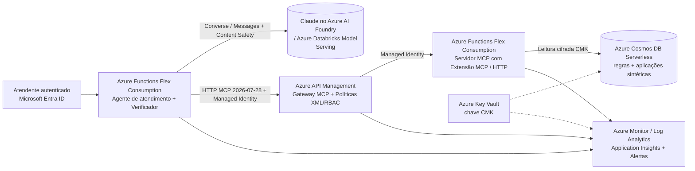

# Cloud comparativa (Azure): design doc do MCP de regras do CDB com liquidez diária

- **Cloud:** Microsoft Azure, escolha do dono para a D03 (D-007). Não implementado; implementar só se for barato validar e com a aprovação do dono.
- **Data das consultas:** 2026-11-22, nas páginas oficiais de `learn.microsoft.com` listadas em "Fontes".
- **Onde fica:** em `specs/03-mcp-regras-cdb/azure.md` durante a fase `planejar` (porque o gate SDD bloqueia `modulos/03-mcp/arquitetura/` antes da fase `implementar`). Na primeira tarefa de `implementar` (`T000`), vai para `modulos/03-mcp/arquitetura/docs/azure.md`, servindo de base para `posts/azure.md` na fase `publicar`.
- **Base:** a arquitetura AWS do `plan.md`, mantendo 100% portáteis o motor determinístico de regras e cálculos em decimal exato, os dados JSON versionados, o verificador de citações `id@versao` e números, e a bateria de casos de teste.

## Diagrama

## Mapeamento serviço a serviço
| Componente | AWS (`plan.md`) | Microsoft Azure | Equivalência | O que muda e por quê | Fonte oficial (consulta em 2026-11-22) |
|---|---|---|---|---|---|
| Gateway MCP e governança de tools | Amazon Bedrock AgentCore Gateway (protocolo MCP nativo, `AWS_IAM`, tradução de versões MCP) | **Azure API Management (APIM)** com suporte a servidores MCP + **Azure API Center** | parcial | O APIM expõe backends REST ou servidores MCP remotos como ativos MCP governados, aplicando autenticação Microsoft Entra ID (OAuth 2.0 / Managed Identity), rate limiting e inspeção de cabeçalhos (`MCP-Protocol-Version`, `Mcp-Method`, `Mcp-Name`). Diferença principal: o APIM tem custo fixo por hora nas camadas Standard/Premium (e mesmo a camada Consumption tem modelo de políticas XML em vez de motor Cedar nativo) | [Expose and govern MCP servers in Azure API Management](https://learn.microsoft.com/en-us/azure/api-management/mcp-server-overview); [Azure API Center](https://learn.microsoft.com/en-us/azure/api-center/overview) |
| Motor de política por tool e checagem de guardrail na tool | Amazon Bedrock AgentCore Policy (Cedar em `ENFORCE` + `InvokeGuardrailChecks` por classe da tool) | **Políticas de entrada do APIM** (`validate-azure-ad-token`, `check-header`, `llm-content-safety`) + **Azure RBAC / Entra ID App Roles** | parcial | Não há motor Cedar gerenciado no gateway de MCP da Azure. A autorização por tool (`permit` das 4 tools do agente e negação de `listar_versoes_regra`) vira validação de *App Roles* ou claims no token Entra ID dentro da política XML do APIM por operação/header `Mcp-Name`, combinada com a política `llm-content-safety` do APIM chamando o Azure AI Content Safety | [APIM AI gateway policies](https://learn.microsoft.com/en-us/azure/api-management/genai-gateway-capabilities); [llm-content-safety policy](https://learn.microsoft.com/en-us/azure/api-management/llm-content-safety-policy) |
| Compute do servidor MCP sem estado | AWS Lambda (Node.js 22, `arm64`, Function URL com `AWS_IAM`) | **Azure Functions** (plano **Flex Consumption**, HTTP trigger ou extensão MCP `mcpToolTrigger`) | direta | Escala a zero sem custo ocioso e atende perfeitamente ao protocolo MCP `2026-07-28` sem estado. Para manter a negociação explícita entre `2026-07-28` e a lane `2025-11-25` com controle total sobre os cabeçalhos `Mcp-Method` e `Mcp-Name`, usa-se HTTP trigger com o mesmo roteador JSON-RPC portátil da AWS (a extensão `mcpToolTrigger` abstrai o transporte, mas amarra a versão suportada pelo binding) | [Azure Functions MCP extension](https://learn.microsoft.com/en-us/azure/azure-functions/functions-bindings-mcp); [Flex Consumption plan](https://learn.microsoft.com/en-us/azure/azure-functions/flex-consumption-plan) |
| Compute do agente de atendimento | AWS Lambda (Node.js 22, `arm64`) | **Azure Functions** (plano **Flex Consumption**) | direta | Mesma execução efêmera por turno de atendimento, com Managed Identity própria | [Flex Consumption plan](https://learn.microsoft.com/en-us/azure/azure-functions/flex-consumption-plan) |
| Acesso ao modelo Claude | Amazon Bedrock (`bedrock-runtime`, `Converse`, perfil de inferência de aplicação do produto) | **Azure AI Foundry** (catálogo de modelos / Model Router) ou **Azure Databricks Model Serving** (modelos Claude da Anthropic, quando habilitados na região/assinatura) | parcial | Na AWS o Claude é nativo no Bedrock (`bedrock-runtime`). Na Azure, a disponibilidade direta dos modelos Claude no catálogo do Azure AI Foundry depende de oferta de parceiro/região (ou passa por Azure Databricks / endpoint externo governado pelo AI Gateway do APIM). Além disso, não há equivalente 1:1 ao *Application Inference Profile* para taguear custo de um mesmo endpoint base sem separar o deployment/recurso no Azure AI Foundry | [Azure AI Foundry Models](https://learn.microsoft.com/en-us/azure/ai-foundry/concepts/models-overview); [Azure AI Agent Service MCP](https://learn.microsoft.com/en-us/azure/ai-foundry/agents/how-to/tools/model-context-protocol) |
| Guardrail do modelo (ataque de prompt, conteúdo, PII e tópico negado) | Amazon Bedrock Guardrails (`STANDARD`, `PROMPT_ATTACK`, regex CPF/CNPJ, tópico negado `"recomendação de investimento personalizada"`) | **Azure AI Content Safety** (Prompt Shields para jailbreak/injeção indireta, categorias de dano, listas de bloqueio / *Groundedness Detection*) | parcial | O Prompt Shields cobre ataques diretos e indiretos e integra-se ao APIM e ao Azure AI Foundry. Porém, não possui um classificador semântico de "tópicos negados por descrição" idêntico ao *Denied Topics* do Bedrock Guardrails; para barrar `"recomendação de investimento personalizada"` na borda é preciso combinar *Custom Categories* do Content Safety com a regra determinística de escalonamento do agente (`RF-019`) | [Azure AI Content Safety Prompt Shields](https://learn.microsoft.com/en-us/azure/ai-services/content-safety/concepts/jailbreak-detection); [Custom categories](https://learn.microsoft.com/en-us/azure/ai-services/content-safety/concepts/custom-categories) |
| Armazenamento de regras versionadas e aplicações sintéticas | Amazon DynamoDB sob demanda (2 tabelas, KMS CMK, PITR) | **Azure Cosmos DB for NoSQL (modo Serverless)** com CMK no Key Vault e backup contínuo (7 dias) | direta | Cobrança puramente por Request Unit (RU) consumida e armazenamento em GB, sem custo mínimo ocioso, com restauração point-in-time no modo de backup contínuo de 7 dias e RBAC do plano de dados (`Cosmos DB Built-in Data Reader` para a Function do servidor MCP) | [Azure Cosmos DB serverless](https://learn.microsoft.com/en-us/azure/cosmos-db/serverless); [Continuous backup](https://learn.microsoft.com/en-us/azure/cosmos-db/continuous-backup-restore-introduction) |
| Contrato entre plataforma e produto | AWS Systems Manager (SSM) Parameter Store (`String` padrão, gratuito) | **Azure App Configuration** (camada Free/Standard) | direta | Chaves hierárquicas `/00-plataforma-agentes/contrato/v1/comum` e `/produtos/03-mcp-regras-cdb` lidas com Managed Identity (`App Configuration Data Reader`) | [Azure App Configuration](https://learn.microsoft.com/en-us/azure/azure-app-configuration/overview) |
| Criptografia (chave do cliente) | AWS KMS (CMK com rotação anual, US$ 1/mês rateado por hora) | **Azure Key Vault** (chave RSA/EC protegida por software, com política de rotação) | direta | Custo de ~US$ 1/mês por versão ativa de chave com rotação configurada e US$ 0,03 por 10.000 operações | [Azure Key Vault pricing](https://azure.microsoft.com/en-us/pricing/details/key-vault/) |
| Logs, métricas e traces | CloudWatch Logs, CloudWatch EMF, AWS X-Ray (`aws/spans`) | **Azure Monitor Logs (Log Analytics)** + **Application Insights** (OpenTelemetry) | parcial | Não há formato EMF embutido no stdout sem coletor: a Function publica métricas customizadas e spans via SDK OpenTelemetry para o Application Insights, com retenção configurada para 7/30 dias | [Azure Monitor OpenTelemetry](https://learn.microsoft.com/en-us/azure/azure-monitor/app/opentelemetry-overview) |
| Alarmes e notificações | CloudWatch Alarms (5 min, `Sum`) + Amazon SNS cifrado | **Azure Monitor Metric/Log Alerts** + **Action Groups** (e-mail/webhook) | direta | Action Groups enviam e-mail direto aos destinatários da conta sem exigir provisionamento de um tópico de mensageria separado | [Azure Monitor alerts](https://learn.microsoft.com/en-us/azure/azure-monitor/alerts/alerts-overview) |
| Orçamento do laboratório | AWS Budgets **diário** (`time_unit = "DAILY"`) filtrado pela tag `project` | **Microsoft Cost Management Budgets** filtrado por Resource Group ou tag `project` | parcial | Os orçamentos do Azure Cost Management operam em períodos mensais, trimestrais ou anuais (não há `time_unit = "DAILY"` nativo); a aproximação no lab de 1 dia é um orçamento mensal com o valor do teto diário (`US$ 0,50`) dedicado ao Resource Group do projeto, que dispara no mesmo dia se o gasto ultrapassar o teto | [Tutorial: Create and manage Azure budgets](https://learn.microsoft.com/en-us/azure/cost-management-billing/costs/tutorial-acm-create-budgets) |
| Identidade e isolamento | IAM Roles por função + ABAC pela tag `project` em conta única (D-029) | **User-Assigned Managed Identities** + **Azure Resource Group** por projeto (`rg-03-mcp-regras-cdb`) + Azure RBAC | direta | Na Azure, o Resource Group oferece um contorno nativo de ciclo de vida e orçamento: o destroy equivale a remover o Resource Group inteiro e verificar recursos órfãos por tag no Azure Resource Graph | [Managed identities for Azure resources](https://learn.microsoft.com/en-us/entra/identity/managed-identities-azure-resources/overview) |

## O que não muda
O núcleo de negócio e de verificação da D03 é 100% independente de nuvem:
1. Os arquivos JSON versionados (`regras_cdb.json` e `aplicacoes_clientes.json`) e seus JSON Schemas;
2. O motor de cálculo decimal determinístico (`simular_resgate` e `verificar_aporte`) com diferença zero contra a bateria calculada à mão;
3. O roteador HTTP sem estado do protocolo MCP (`2026-07-28` e lane `2025-11-25`) e o envelope de erro estruturado com `isError: true`;
4. O verificador determinístico de citações `id@versao` e números (`RF-018`), a injeção do `cliente_id` pelo contexto autenticado (`RF-021`) e a máquina de estados do loop do agente (`RF-017`, `RF-019`, `RF-020`).

## Onde a migração dói
1. **Substituição do Cedar pelo XML de políticas do APIM + App Roles:** na AWS, o módulo `registro-produto` compila o catálogo de classes em políticas Cedar avaliadas pelo AgentCore Policy Engine. Na Azure, a autorização por tool e o filtro do `tools/list` precisam ser traduzidos para políticas XML do APIM (`choose`/`when` sobre o cabeçalho `Mcp-Name` e claims JWT do Entra ID), perdendo a validação formal de política do Cedar.
2. **Acesso ao modelo Claude:** enquanto no Amazon Bedrock o Claude Haiku 5.5 é serviço de primeira classe com IAM SigV4, na Azure é necessário contratar o endpoint via parceiro/Azure Databricks ou rotear pelo AI Gateway do APIM para a API da Anthropic com credencial gerenciada no Key Vault.
3. **Classificador de tópicos negados:** substituir o *Denied Topics* declarativo do Bedrock Guardrails por *Custom Categories* treinadas/configuradas no Azure AI Content Safety.
4. **Custo de partida e tempo de provisionamento do APIM:** instâncias tradicionais do APIM levam mais tempo para subir/destruir e têm custo por hora superior ao modelo puramente por requisição do AgentCore Gateway.

## Fontes (consulta em 2026-11-22)
- Azure API Management, visão geral de servidores MCP: https://learn.microsoft.com/en-us/azure/api-management/mcp-server-overview
- Azure API Management, capacidades de AI Gateway e `llm-content-safety`: https://learn.microsoft.com/en-us/azure/api-management/genai-gateway-capabilities e https://learn.microsoft.com/en-us/azure/api-management/llm-content-safety-policy
- Azure Functions, extensão MCP (`mcpToolTrigger`): https://learn.microsoft.com/en-us/azure/azure-functions/functions-bindings-mcp
- Azure Functions, plano Flex Consumption: https://learn.microsoft.com/en-us/azure/azure-functions/flex-consumption-plan
- Azure AI Foundry, integração de agentes com MCP: https://learn.microsoft.com/en-us/azure/ai-foundry/agents/how-to/tools/model-context-protocol
- Azure AI Content Safety, Prompt Shields e Custom Categories: https://learn.microsoft.com/en-us/azure/ai-services/content-safety/concepts/jailbreak-detection e https://learn.microsoft.com/en-us/azure/ai-services/content-safety/concepts/custom-categories
- Azure Cosmos DB Serverless e Continuous Backup: https://learn.microsoft.com/en-us/azure/cosmos-db/serverless e https://learn.microsoft.com/en-us/azure/cosmos-db/continuous-backup-restore-introduction
- Microsoft Cost Management Budgets: https://learn.microsoft.com/en-us/azure/cost-management-billing/costs/tutorial-acm-create-budgets
- Âncora AWS (*MCP went stateless*, 01/09/2026): https://aws.amazon.com/blogs/architecture/mcp-went-stateless-is-your-aws-mcp-server-deployment-well-architected
