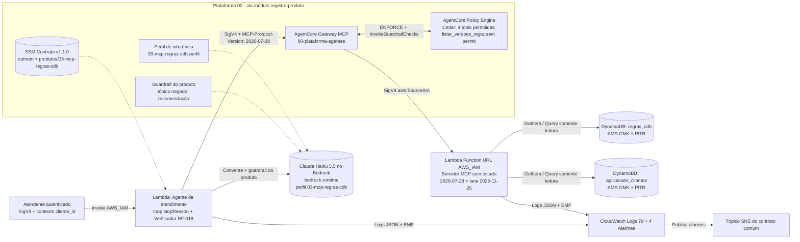

# Plano: MCP de regras do CDB com liquidez diária

- **Spec:** `specs/03-mcp-regras-cdb/spec.md` · **Status:** rascunho, pronto para a aprovação do dono (D-033). Nada aqui vale como aprovado até o comando `estado.py aprovar-plano`
- **Data:** 2026-11-22 · **Autor:** arquiteto-aws (orquestração Antigravity), em plan mode, sem chamada de escrita à AWS
- **Decisões do dono aplicadas:** D-001, D-006, D-007, D-008, D-011, D-013, D-021, D-022, D-024, D-029, D-030, D-031, D-033, D-034, D-039, D-044, D-062, D-065, D-068, D-069, D-071 e D-072
- **ADRs:** `specs/03-mcp-regras-cdb/adr/`. O gate SDD (`harness/estado.py checar-arquivos`, hook e `pre-commit`) bloqueia `modulos/03-mcp/arquitetura/` antes da fase `implementar`; a tarefa `T000` de `implementar` move os ADRs para `modulos/03-mcp/arquitetura/adr/` e `azure.md` para `modulos/03-mcp/arquitetura/docs/azure.md`
- **Âncora (D-065):** *MCP went stateless: Is your AWS MCP server deployment well-architected?*, AWS Architecture Blog, 01/09/2026, conferida em 2026-11-22 ([ADR-0001](adr/0001-arquitetura-ancora-mcp-sem-estado.md))

## Resumo
- **Implementação limpa a partir do SDD.** Não há código pré-SDD da D03 no repositório. Todo código, schema, dado sintético e Terraform nasce na fase `implementar` com teste vermelho primeiro.
- **Servidor MCP sem estado (`2026-07-28`) com lane de compatibilidade (`2025-11-25`, D-072):**
  - Roda em **AWS Lambda** (Node.js 22, `arm64`, fora de VPC) com **Lambda Function URL** protegida por `AWS_IAM` e política de recurso restrita ao `aws:SourceArn` do AgentCore Gateway da plataforma ([ADR-0001](adr/0001-arquitetura-ancora-mcp-sem-estado.md), [ADR-0002](adr/0002-protocolo-mcp-2026-07-28-e-lane-2025-11-25.md)).
  - Lê regras fiscais/produto e aplicações sintéticas de clientes (`CLI-000101` a `CLI-000104`) de duas tabelas **Amazon DynamoDB** sob demanda cifradas com KMS (`03-mcp-regras-cdb-regras` e `03-mcp-regras-cdb-aplicacoes`), abastecidas por arquivos JSON versionados no repositório e validados por JSON Schema ([ADR-0003](adr/0003-regras-versionadas-e-calculo-deterministico.md)).
  - Expõe 4 tools para o agente (`buscar_regras`, `simular_resgate`, `verificar_aporte` e `consultar_aplicacoes_cliente`), 1 tool administrativa sem agente chamador (`listar_versoes_regra`, para provar filtro de `tools/list` e negação por padrão no Cedar, `RF-023`) e o catálogo de regras como resources (`resources/list` e `resources/read`, `RF-010`).
- **Primeiro consumidor da `00-plataforma-agentes` (D-034, [ADR-0004](adr/0004-consumo-da-plataforma-e-classe-leitura-publica.md)):**
  - Registra alvo `mcp_server`, classes das tools (`leitura_publica` da emenda `1.1.0` aprovada em `D03-P10 = A` e `dado_privado` em `consultar_aplicacoes_cliente`), políticas Cedar, guardrail do produto (1 tópico negado: `"recomendação de investimento personalizada"`, `D03-P6 = A`), perfil de inferência de aplicação (Claude Haiku 5.5) e roles exclusivamente pelo módulo `registro-produto` da plataforma.
- **Agente de atendimento com verificador determinístico ([ADR-0005](adr/0005-agente-converse-verificador-e-identidade-do-canal.md)):**
  - Roda em **AWS Lambda** (`03-mcp-regras-cdb-agente`), chama o Claude Haiku 5.5 via `bedrock-runtime` (`Converse`) com o perfil e o guardrail do produto, injeta o `cliente_id` a partir do contexto autenticado do atendente (`RF-021`), limita o loop a 6 chamadas de tool por turno (`RF-017`) e valida toda resposta final com um verificador determinístico de citações `id@versao` e números antes de entregá-la (`RF-018`).
- **Custo de um dia (só o stack da D03):** estimativa de **US$ 0,39** (24 h no ar + rodada real de 80 turnos / 200 chamadas ao modelo); pior caso limitado por cota diária de 300.000 tokens no agente: **US$ 0,58**. **Teto diário proposto (`D03-P7`): US$ 0,50** (aguardando aprovação do dono junto com este plano).

## Verificação da constituição
| Artigo | Como o plano cumpre | Risco |
|---|---|---|
| I · SDD | Spec esclarecida (`D-071`, `D-072`) e este plano. `tasks.md` só depois da aprovação do plano pelo dono (D-033). ADRs e `azure.md` ficam em `specs/03-mcp-regras-cdb/` até a fase `implementar` | nenhum |
| II · Decisões do dono | `D03-P1`, `D03-P2`, `D03-P4`, `D03-P5`, `D03-P6`, `D03-P9` e `D03-P10` respondidas pelo dono em 2026-11-22 (`D-071`). O valor do teto diário (`D03-P7`) e a aprovação do plano (`D03-P11`) estão propostos abaixo e não são assumidos | `teto_diario_usd` permanece `null` no `harness/estado.json` até o sim do dono |
| III · Testes primeiro | Matriz regra → teste abaixo cobrindo 100% dos requisitos (`RF-001` a `RF-025` e `RNF-001` a `RNF-007`). `UT` para cálculos, schema, verificador e loop; `CT` com cliente MCP HTTP em processo para `2026-07-28` e `2025-11-25`; `RG` com respostas gravadas (D-006); `TT` com mock provider; `FL` no Floci com o projeto completo | Invocação MCP pelo AgentCore Gateway, Cedar e Guardrail não são emulados no Floci: prova em `TT`, `CT`, `RG` e `DM` ([ADR-0006](adr/0006-custo-diario-seguranca-e-cobertura-do-floci.md)) |
| IV · Segurança por padrão | Nada público (`AWS_IAM` nas duas Lambdas; política de recurso do servidor restrita ao `aws:SourceArn` do gateway; zero `Principal "*"` e zero curinga em condição de conta, `D-044`); KMS do cliente com rotação nas 2 tabelas DynamoDB, nos grupos de log e nas variáveis de ambiente; roles separadas para servidor e agente sem ação `*` e sem escrita nas tabelas; `cliente_id` injetado pelo canal autenticado (`RF-021`); tríade letal barrada no módulo `registro-produto` | Role de deploy única na conta (D-029), mitigada por ABAC e gate do harness |
| V · Custo consciente | Só serviços serverless cobrados por uso (Lambda, DynamoDB sob demanda, Bedrock por token/unidade, KMS por hora); zero NAT, zero VPC interface endpoint, zero cluster/instância; AWS Budgets diário com `var.teto_diario_usd`; workflows de apply (`prazo_horas`) e destroy (`confirm_stack`, sobras, `aws-lab-destroy`) gerados de `harness/modelos/`; destroy da D03 antes do da plataforma | Teto proposto de US$ 0,50 aguarda aprovação (`D03-P7`) |
| VI · Operável e replicável | Tags `project = 03-mcp-regras-cdb`, `module` em kebab e `managed-by = terraform` (D-031) testadas com `tags.tftest.hcl`; prefixo `03-mcp-regras-cdb-` (exceções da API no [ADR-0006](adr/0006-custo-diario-seguranca-e-cobertura-do-floci.md)); 4 alarmes do servidor + 1 do guardrail no tópico do contrato `comum`; retenção de 7 dias nos logs; state remoto com `use_lockfile = true`; README com até 5 passos | nenhum |
| VII · Lente da certificação | Componente Claude e servidor MCP mapeados para as tarefas 1.1, 1.4, 2.1, 2.2, 2.3, 2.4, 4.1, 4.4, 5.2, 5.3 e 5.6 da prova CCAR-F; cada ADR traz os ids, o curso Skilljar e o que um arquiteto sênior faria em produção | nenhum |
| VIII · Proveniência e privacidade | Âncora e fontes normativas/técnicas datadas e conferidas; produto CDB e clientes `CLI-000101` a `CLI-000104` 100% sintéticos (`sintetico: true`, zero PII); logs do servidor omitem argumentos de `dado_privado` (`RF-025`); relatório da demonstração revisado pelo dono antes de entrar no repositório | nenhum |

## Arquitetura

### Visão geral

**Ordem do dia de demonstração ([ADR-0006](adr/0006-custo-diario-seguranca-e-cobertura-do-floci.md)):**
1. Apply da `00-plataforma-agentes` (`prazo_horas = 24`);
2. Apply da `03-mcp-regras-cdb` (`prazo_horas = 8`, sempre `<= prazo_plataforma - 1 h`), que sobe o servidor MCP, carrega as regras e aplicações sintéticas no DynamoDB e instancia o módulo `registro-produto`;
3. Execução do roteiro de demonstração (`RF-023`: 4 passos da plataforma + histórias H1, H2, H3, H5, H6 e rodada real de avaliação), seguida do workflow de evidências da plataforma (`--produto 03-mcp-regras-cdb`);
4. Destroy da `03-mcp-regras-cdb` (limpa políticas Cedar e alvo do gateway, depois destrói Lambdas, tabelas e logs e confere sobras pela tag `project=03-mcp-regras-cdb`);
5. Destroy da `00-plataforma-agentes`.

### Serviços AWS
Fontes de preço: AWS Price List (`us-east-1`), consultadas em 2026-11-22. Floci: [lista de serviços emulados](https://floci.io/floci/services/).

| Serviço | Papel na D03 | Por que este | Alternativa rejeitada | Fonte oficial da AWS | Floci (`floci/floci:2.5.0`) |
|---|---|---|---|---|---|
| AWS Lambda (Node.js 22, `arm64`, fora de VPC) + Function URL (`AWS_IAM`) | Servidor MCP sem estado (`03-mcp-regras-cdb-servidor`) e agente de atendimento (`03-mcp-regras-cdb-agente`) | Escala a zero com custo ocioso nulo; Function URL com `AWS_IAM` é suportada nativamente como alvo `mcp_server` assinado por SigV4 pelo AgentCore Gateway ([ADR-0001](adr/0001-arquitetura-ancora-mcp-sem-estado.md)) | ECS Fargate + ALB (custo fixo por hora e ALB não valida SigV4 nativamente na borda); API Gateway REST na frente da Lambda do servidor (adiciona latência e custo por milhão sem necessidade, pois o AgentCore Gateway já é a borda governada) | [Preços do Lambda](https://aws.amazon.com/lambda/pricing/); [Gateway target MCP servers](https://docs.aws.amazon.com/bedrock-agentcore/latest/devguide/gateway-target-MCPservers.html) | Lambda e Function URL emuladas |
| Amazon DynamoDB (sob demanda, KMS CMK, PITR) | Tabelas `03-mcp-regras-cdb-regras` (partição `tema`, ordenação `id_versao`) e `03-mcp-regras-cdb-aplicacoes` (partição `cliente_id`, ordenação `aplicacao_id`) | Custo ocioso zero, leitura em milissegundos (`p95 <= 500 ms`, `RNF-007`) e separação entre compute sem estado e dados versionados ([ADR-0003](adr/0003-regras-versionadas-e-calculo-deterministico.md)) | Aurora Serverless v2 (custo mínimo por ACU-hora); S3 Select/leitura de S3 a cada chamada (maior latência por invocação) | [Preços do DynamoDB](https://aws.amazon.com/dynamodb/pricing/) | Emulado |
| Amazon Bedrock AgentCore Gateway e Policy (via módulo `registro-produto`) | Ponto único de entrada MCP do agente, filtro de `tools/list`, avaliação Cedar em `ENFORCE` e `InvokeGuardrailChecks` nas tools ([ADR-0004](adr/0004-consumo-da-plataforma-e-classe-leitura-publica.md)) | Governança centralizada fora do modelo; prova a plataforma como primeiro consumidor (D-034) | Chamada direta do agente à Lambda do servidor MCP (viola `RF-017` e `RF-022`); autorização no código da tool | [Gateway com Policy](https://docs.aws.amazon.com/bedrock-agentcore/latest/devguide/use-gateway-with-policy.html); [Preços do AgentCore](https://aws.amazon.com/bedrock/agentcore/pricing/) | Plano de controle do gateway/alvos emulado; invocação MCP e Policy Engine não emulados (`TT`, `CT`, `RG`, `DM`) |
| Amazon Bedrock (`bedrock-runtime`, API `Converse`) | Modelo **Claude Haiku 5.5** para o agente de atendimento ([ADR-0005](adr/0005-agente-converse-verificador-e-identidade-do-canal.md)) | Toda a aritmética está nas tools determinísticas; o Haiku 5.5 seleciona tools e redige a resposta citando `id@versao` com baixa latência e US$ 0,11 / US$ 0,55 por milhão de tokens | Claude Opus 5.5 ou Sonnet 5.5 como modelo padrão do turno (20x a 100x mais caro para um catálogo fechado de 4 tools determinísticas) | [Ficha do Claude Haiku 5.5](https://docs.aws.amazon.com/bedrock/latest/userguide/model-card-anthropic-claude-haiku-5-5.html); [Preços do Bedrock](https://aws.amazon.com/bedrock/pricing/) | Bedrock Runtime emulado; no Floci o agente roda com respostas gravadas |
| Perfil de inferência de aplicação (via `registro-produto`) | `03-mcp-regras-cdb-perfil` com tag `project = 03-mcp-regras-cdb` | Rastreamento de custo de tokens por produto e restrição IAM da role do agente ao próprio perfil (`RF-022`) | Invocação direta do foundation model sem perfil (impede isolamento de custo por tag em conta única) | [Inference profiles](https://docs.aws.amazon.com/bedrock/latest/userguide/inference-profiles-create.html) | Não documentado no Floci: `TT` e `DM` |
| Amazon Bedrock Guardrails (via `registro-produto`) | `03-mcp-regras-cdb-guardrail` na camada `STANDARD`, com a base da plataforma mais o tópico negado `"recomendação de investimento personalizada"` (`D03-P6 = A`, `RF-024`) | Bloqueia ataques de prompt, PII/credenciais e pedidos de consultoria financeira já na borda do modelo | Filtro apenas no prompt do sistema (contornável por jailbreak) | [Bedrock Guardrails](https://docs.aws.amazon.com/bedrock/latest/userguide/guardrails-components.html) | Fora de escopo no Floci: `TT`, `RG` e `DM` |
| AWS Systems Manager (SSM) Parameter Store (`String` padrão) | Leitura do contrato `comum` da plataforma e gravação/leitura de `/00-plataforma-agentes/contrato/v1/produtos/03-mcp-regras-cdb` | Gratuito na camada padrão (até 4 KB), desacopla o state da D03 do state da plataforma | `terraform_remote_state` lendo o bucket S3 da plataforma (viola menor privilégio entre stacks) | [SSM Parameter Store](https://docs.aws.amazon.com/systems-manager/latest/userguide/parameter-store-advanced-parameters.html) | Emulado |
| AWS KMS | Chave do cliente `03-mcp-regras-cdb-kms` com rotação automática | Cifra DynamoDB, CloudWatch Logs e variáveis das Lambdas com política de chave restrita por serviço ([ADR-0006](adr/0006-custo-diario-seguranca-e-cobertura-do-floci.md)) | Chave gerenciada padrão da AWS (não permite controle granular de política de chave por role) | [Preços do KMS](https://aws.amazon.com/kms/pricing/) | Emulado |
| Amazon CloudWatch (Logs JSON, EMF, 4 alarmes do servidor + 1 do guardrail) | Retenção de 7 dias, métricas por tool e por categoria de erro via EMF, alarmes publicando no tópico SNS do contrato `comum` (`RF-025`) | EMF evita chamadas `PutMetricData`; reutiliza o tópico SNS cifrado da plataforma | Criar tópico SNS novo na D03 (proibido por `RNF-001`) | [Preços do CloudWatch](https://aws.amazon.com/cloudwatch/pricing/) | Logs, Metrics e Alarms emulados |
| AWS X-Ray | Rastreamento ativo nas duas Lambdas (`tracing_config { mode = "Active" }`) e correlação W3C Trace Context com os spans do gateway | Visibilidade ponta a ponta agente → gateway → servidor MCP → DynamoDB | Apenas logs sem trace ID distribuído | [Preços do X-Ray](https://aws.amazon.com/xray/pricing/) | Emulado |
| AWS Budgets | Orçamento **diário** `03-mcp-regras-cdb-budget-diario` filtrado por `user:project$03-mcp-regras-cdb` | Gratuito e exigido pelo Art. V e `RNF-002` | Apenas o orçamento mensal da conta | [Preços do Budgets](https://aws.amazon.com/aws-cost-management/aws-budgets/pricing/) | Emulado |
| AWS IAM | Roles separadas: `03-mcp-regras-cdb-servidor-role` (só lê as 2 tabelas DynamoDB e grava logs/X-Ray), `03-mcp-regras-cdb-agente-atendimento` e `03-mcp-regras-cdb-aprovacao` (criadas pelo `registro-produto`) | Menor privilégio estrito por função, sem curinga de ação | Role única compartilhada entre servidor e agente (permitiria ao servidor invocar o Bedrock ou ao agente ler o DynamoDB contornando o MCP) | [IAM Best Practices](https://docs.aws.amazon.com/IAM/latest/UserGuide/best-practices.html) | Emulado |

### Estrutura de módulos e pastas (`modulos/03-mcp/arquitetura/`)
Criada na fase `implementar`:
- `dados/regras_cdb.json` e `dados/aplicacoes_clientes.json` (com `"sintetico": true`);
- `schemas/regra.schema.json` e `schemas/aplicacoes.schema.json`;
- `src/servidor/`:
  - `protocolo/roteador-mcp.ts` (versão `2026-07-28` sem estado e lane `2025-11-25`, validação de `MCP-Protocol-Version`, `Mcp-Method`, `Mcp-Name`, erros `-32020` e `-32600`);
  - `dominio/calculo-cdb.ts` (motor decimal determinístico: acúmulo CDI base 252, tabela IOF 1–29 dias, tabela IR regressivo sobre `rendimento - IOF`, verificação de aporte, dias úteis ANBIMA, arredondamento `HALF_UP`);
  - `tools/` (`buscar-regras.ts`, `simular-resgate.ts`, `verificar-aporte.ts`, `consultar-aplicacoes-cliente.ts`, `listar-versoes-regra.ts`) e `resources/catalogo-regras.ts`;
  - `infra/repositorio-dynamodb.ts` e `handler.ts` (Lambda Function URL + logger estruturado sem `dado_privado` + métricas EMF);
- `src/agente/`:
  - `loop-converse.ts` (controle por `stopReason`, limite de 6 chamadas de tool, injeção de `cliente_id` do contexto autenticado, `RF-017` e `RF-021`);
  - `verificador-resposta.ts` (validação determinística de números e citações `id@versao` com até 1 retentativa, `RF-018`);
  - `classificador-erros.ts` (3 camadas de erro + retentativa exponencial 1, 2 e 4 s para `dados_indisponiveis` e `falha_transitoria` + `handoff_humano`, `RF-019` e `RF-020`);
  - `cliente-gateway-mcp.ts` (chamadas HTTP assinadas com SigV4 ao `gateway_url` lido do contrato SSM);
- `infra/terraform/`:
  - `main.tf`, `variables.tf`, `outputs.tf`, `versions.tf` (backend `s3` parcial com `use_lockfile = true`);
  - `modules/nucleo` (KMS e AWS Budgets diário);
  - `modules/dados` (2 tabelas DynamoDB cifradas com KMS + PITR e carga inicial dos JSONs versionados);
  - `modules/servidor-mcp` (Lambda do servidor, Function URL `AWS_IAM`, `aws_lambda_permission` restrita ao `aws:SourceArn` do gateway, role sem escrita);
  - `modules/agente` (Lambda do agente consumindo a role e os parâmetros criados pelo `registro-produto`);
  - `modules/observabilidade` (log groups de 7 dias com KMS e os 4 alarmes do servidor no tópico SNS do contrato `comum`);
  - chamada ao módulo `../../../../plataforma/agentes/infra/terraform/modules/registro-produto`;
  - `tests/` (`tags.tftest.hcl`, `seguranca.tftest.hcl`, `custo.tftest.hcl`, `consumo_plataforma.tftest.hcl`, `observabilidade.tftest.hcl`).

## Decisões técnicas (ADRs)
- [ADR-0001](adr/0001-arquitetura-ancora-mcp-sem-estado.md): arquitetura âncora (*MCP went stateless*, AWS Architecture Blog, 01/09/2026), o que segue e o que muda (tarefas da prova: 1.4, 2.1, 2.3, 2.4, 5.6)
- [ADR-0002](adr/0002-protocolo-mcp-2026-07-28-e-lane-2025-11-25.md): protocolo MCP `2026-07-28` sem estado, lane `2025-11-25` (D-072) e erros estruturados em dupla representação (tarefas da prova: 2.2, 2.4)
- [ADR-0003](adr/0003-regras-versionadas-e-calculo-deterministico.md): regras versionadas em dados, cálculo decimal determinístico e aplicações sintéticas de clientes (tarefas da prova: 2.1, 4.1, 5.6)
- [ADR-0004](adr/0004-consumo-da-plataforma-e-classe-leitura-publica.md): consumo integral da `00-plataforma-agentes`, classe `leitura_publica` (`v1.1.0`, `D03-P10 = A`) e negação por padrão no Cedar (tarefas da prova: 1.4, 2.1, 2.3)
- [ADR-0005](adr/0005-agente-converse-verificador-e-identidade-do-canal.md): agente de atendimento via Bedrock `Converse`, verificador determinístico de citações e números, e identidade do cliente pelo canal (tarefas da prova: 1.1, 1.4, 4.4, 5.2, 5.3)
- [ADR-0006](adr/0006-custo-diario-seguranca-e-cobertura-do-floci.md): custo diário, segurança em conta única e cobertura/lacunas do Floci (tarefas da prova: 3.6, 4.5, 5.6)

## Modelo de ameaças

### Fluxo de dados e fronteiras de confiança
| id | Fronteira | Atores e dados que cruzam |
|---|---|---|
| F1 | GitHub Actions → AWS | Role de deploy da conta via OIDC; Terraform; state no S3 |
| F2 | Canal do atendente → Lambda do agente (`03-mcp-regras-cdb-agente`) | Chamada autenticada por `AWS_IAM`; `contexto_autenticado` (`atendente_id`, `cliente_id` confiáveis vindos do canal) e `pergunta` em texto livre (não confiável) |
| F3 | Lambda do agente → Amazon Bedrock (`bedrock-runtime` + Guardrail) | Prompt com `pergunta`, definições das 4 tools e resultados das tools; saída do modelo Claude (não confiável até passar pelo verificador `RF-018`) |
| F4 | Lambda do agente → AgentCore Gateway → Lambda do servidor MCP | Requisição HTTP MCP assinada com SigV4; avaliação Cedar no Policy Engine e `InvokeGuardrailChecks`; invocação da Function URL restrita ao `aws:SourceArn` do gateway |
| F5 | Lambda do servidor MCP → DynamoDB (`regras` e `aplicacoes`) | Leitura (`GetItem`/`Query`) cifrada com KMS; dados de `aplicacoes` classificados como `dado_privado` |
| F6 | Lambdas → CloudWatch Logs, EMF e X-Ray | Logs JSON estruturados (sem argumentos de `dado_privado`), métricas e spans |

### STRIDE por fronteira
| Ameaça | Fronteira | Mitigação | Teste que prova a mitigação |
|---|---|---|---|
| **S (Spoofing):** chamada direta à Function URL do servidor MCP contornando o gateway da plataforma | F4 | `authorization_type = "AWS_IAM"` na Function URL; `aws_lambda_permission` libera apenas a role do gateway com `aws:SourceArn` igual ao ARN do gateway do contrato `comum`; zero `Principal "*"` (`D-044`) | `TT-SEC-01`, `DM-01` |
| **S / E (Spoofing / Elevation):** prompt injection na pergunta tenta consultar aplicações de outro cliente (`CLI-000104` em atendimento aberto para `CLI-000101`) | F2, F3, F4 | O adaptador do agente ignora qualquer `cliente_id` sugerido pelo texto/modelo e injeta `contexto_autenticado.cliente_id` antes de chamar o gateway (`RF-021`, [ADR-0005](adr/0005-agente-converse-verificador-e-identidade-do-canal.md)) | `UT-AGT-04`, `RG-07` |
| **T (Tampering):** tentativa de escrita ou alteração de regras/aplicações pelo servidor MCP ou pelo agente | F4, F5 | Nenhuma tool de escrita existe; a role do servidor MCP tem apenas `dynamodb:GetItem` e `dynamodb:Query` nas 2 tabelas; a role do agente não tem nenhuma permissão de DynamoDB (`RF-008`, `RNF-001`) | `TT-IAM-01`, `TT-IAM-02` |
| **T (Tampering):** modelo inventa número de rendimento/imposto ou omite a citação `id@versao` da regra | F3 | Verificador determinístico (`RF-018`) confere que todo número da resposta saiu de uma tool do turno e que há pelo menos uma citação `id@versao` válida; faz no máximo 1 retentativa de correção e escala (`handoff_humano`) se persistir | `UT-VER-01`, `RG-03`, `RG-04` |
| **R (Repudiation):** resposta financeira sem saber qual versão de regra ou taxa DI foi aplicada | F5, F6 | Toda tool retorna `regras_aplicadas` (`id@versao`), `fonte`, `data_fonte`, `premissas` e `incertezas`; o servidor grava log estruturado com `correlation_id`, versão do protocolo, tool e categoria do resultado (`RF-007`, `RF-015`, `RF-025`) | `UT-CALC-01`, `UT-LOG-01` |
| **I (Information Disclosure):** vazamento de `cliente_id` ou argumentos de `dado_privado` nos logs do CloudWatch ou em mensagens de erro | F5, F6 | O logger do servidor redige argumentos de tools marcadas como `dado_privado` (`RF-025`); erros `RF-011` nunca incluem stack trace, caminho de arquivo, nome de tabela ou ARN; IDs de cliente inexistentes e clientes sem aplicação retornam o mesmo payload (`motivo: "cliente_sem_aplicacoes"`, `RF-009`) | `UT-LOG-02`, `UT-ERR-02`, `UT-CLI-02` |
| **D (Denial of Service):** loop infinito de chamadas de tool ou explosão de custo de tokens | F3, F4 | Limite duro de 6 chamadas de tool por turno (`RF-017`, `E14`); `maxTokens = 1024`; retentativa limitada a 3x (1, 2 e 4 s) só em `dados_indisponiveis` e `falha_transitoria`; cota diária de tokens e AWS Budgets diário | `RG-02`, `UT-ERR-03`, `TT-COST-01` |
| **E (Elevation of Privilege):** modelo tenta invocar a tool administrativa `listar_versoes_regra` ou descrições de tools induzem confusão entre tools | F3, F4 | `listar_versoes_regra` é registrada no catálogo sem agente chamador (`permit` ausente no Cedar → negação por padrão no gateway → `politica_negada` → `handoff_humano`, `RF-023`); descrições das tools seguem formato de 4 partes sem sobreposição e passam por bateria de red team (`RF-004`) | `TT-PLAT-02`, `RG-05`, `RG-08`, `DM-02` |

### Fronteiras específicas de LLM e Tríade Letal
- **Prompt injection direta e pedido fora de escopo:** bloqueados em três camadas independentes: (1) Bedrock Guardrail do produto na entrada (`PROMPT_ATTACK = HIGH` e tópico negado `"recomendação de investimento personalizada"`, `RF-024`), (2) `InvokeGuardrailChecks` no AgentCore Policy (`PromptAttack > 0.4`), e (3) regra de escalonamento `handoff_humano` do agente (`RF-019`).
- **Tríade letal (`RF-022`):** o principal `03-mcp-regras-cdb-agente-atendimento` possui `permit` apenas para tools das classes `leitura_publica` (`buscar_regras`, `simular_resgate`, `verificar_aporte`) e `dado_privado` (`consultar_aplicacoes_cliente`). Não possui nenhuma tool com `conteudo_nao_confiavel` nem `canal_saida` (1 de 3 pernas da tríade).

## Estratégia de testes
- **Unitários (`UT`):** Vitest sobre o motor de cálculo decimal (`simular_resgate`, `verificar_aporte`), validação dos JSON Schemas (`regras_cdb.json`, `aplicacoes_clientes.json` e schemas de entrada das 5 tools), verificador determinístico de números e citações (`RF-018`), classificador de erros em 3 camadas (`RF-020`) e logger sem `dado_privado` (`RF-025`).
- **Testes de contrato MCP (`CT`):** cliente MCP HTTP em processo testando o servidor sem estado nas duas versões (`2026-07-28` sem `initialize` e com cabeçalhos `MCP-Protocol-Version`, `Mcp-Method`, `Mcp-Name`; e lane `2025-11-25` com e sem `initialize`, sem `Mcp-Session-Id`), duas instâncias independentes devolvendo o mesmo resultado, recusa de versão desconhecida/cabeçalho incoerente (`-32020` / `-32600`), resources (`resources/list` e `resources/read`) e erros estruturados com `isError: true`.
- **Componente Claude com respostas gravadas (`RG`, D-006):** todos os valores de `stopReason` da API `Converse`, limite de 6 chamadas de tool (7ª chamada vira `handoff_humano`), correção pelo verificador de números/citações, cada linha das duas tabelas de erro, isolamento do `cliente_id` autenticado contra prompt injection, roteiro de 4 passos da plataforma (incluindo a chamada forçada a `listar_versoes_regra` negada por política) e red team das descrições das tools.
- **Infraestrutura (`TT`):** `terraform test` com mock provider (`command = plan`), começando por `harness/modelos/tags.tftest.hcl`, mais regras de segurança (KMS, IAM sem curinga e sem escrita, Function URL `AWS_IAM` sem `Principal "*"`), consumo exclusivo via módulo `registro-produto`, 4 alarmes do servidor + 1 do guardrail e Budgets diário; `checkov` e `tflint` sem achado alto ou crítico.
- **Integração local no Floci (`FL`):** `terraform apply` do root de integração da D03 contra `http://localhost:4566` (`${FLOCI_IMAGE:-floci/floci:2.5.0}`, D-013), asserts de leitura real nas tabelas DynamoDB, chamadas HTTP `2026-07-28` e `2025-11-25`, medição de latência `p95 <= 500 ms` na bateria do critério de sucesso 2 (`RNF-007`), `terraform destroy` sem sobras e relatório HTML em `testing/reports/`.
- **Demonstração real (`DM`):** rodada única na AWS real com a plataforma e a D03 no ar, executando os 4 passos da plataforma e os passos de produto H1, H2, H3, H5 e H6, conferindo `AllowDecisions >= 1`, `DenyDecisions >= 1` e intervenções do guardrail via workflow de evidências da plataforma, custo real do dia e destroy sem sobras.

### Matriz regra → teste
O arquivo `specs/03-mcp-regras-cdb/matriz.md` com a coluna de tarefa nasce na fase `tarefas` a partir desta tabela.

| Regra / Requisito | Teste(s) | O que o teste afirma |
|---|---|---|
| Art. I · código só na fase `implementar` | `TH` (`gate_sdd.py`, `pre-commit`) | Bloqueia qualquer arquivo em `modulos/03-mcp/arquitetura/` antes da fase `implementar` |
| Art. III (`RNF-004`) · cobertura completa | `TH-MAT-01` | Todo `RF-001`..`RF-025` e `RNF-001`..`RNF-007` aparece em `specs/03-mcp-regras-cdb/matriz.md` com pelo menos um teste |
| Art. IV (`RNF-001`) · nada público e D-044 | `TT-SEC-01` | Function URL e Lambda do agente com `AWS_IAM`; `aws_lambda_permission` com `aws:SourceArn` do gateway; zero `Principal "*"` e zero curinga em condição de conta |
| Art. IV (`RNF-001`) · criptografia KMS em repouso e TLS | `TT-SEC-02` | Chave KMS com rotação nas 2 tabelas DynamoDB, nos grupos de log e nas variáveis de ambiente das Lambdas |
| Art. IV (`RNF-001`) · menor privilégio e zero escrita | `TT-IAM-01`, `TT-IAM-02` | Role do servidor só com `GetItem`/`Query` nas 2 tabelas da D03 e logs/X-Ray; nenhuma ação `*` em recurso `*`; zero permissão de escrita no DynamoDB |
| Art. V (`RNF-002`) · sem custo fixo ocioso e Budgets diário | `TT-COST-01`, `TT-COST-02`, `TH-COST-01` | Plan sem NAT, VPC endpoint de interface, cluster ou instância; `aws_budgets_budget` com `time_unit = "DAILY"` e `limit_amount == var.teto_diario_usd` igual ao `estado.json` |
| Art. V (`RNF-002`) · workflows de apply/destroy e prazo | `TH-WF-01`, `estado.py validar` | `.github/workflows/03-mcp-regras-cdb-apply.yml` e `-destroy.yml` seguem `harness/modelos/` (`prazo_horas`, `confirm_stack`, `aws-lab-destroy`, sobras, `infra.py`), e `consome: ["00-plataforma-agentes"]` respeita a margem de 1 h antes da plataforma |
| Art. VI (`RNF-003`) · tags, prefixo, state e README | `TT-TAG-01`, `TT-PRE-01`, `TH-DOC-01` | Tags `project=03-mcp-regras-cdb`, `module` em kebab e `managed-by=terraform`; nomes com prefixo `03-mcp-regras-cdb-` (salvo exceções do ADR-0006); backend `s3` com `use_lockfile = true`; README com até 5 passos |
| Art. VIII (`RNF-005`) · fontes oficiais e dados sintéticos | `UT-DAT-01`, `UT-DAT-02` | Toda regra pública tem `fonte.url` em domínio oficial (`planalto.gov.br`, `gov.br/receitafederal`, `bcb.gov.br`, `b3.com.br`, `anbima.com.br`); fixtures declaram `sintetico: true` e zero CPF/PII |
| `RF-001` · MCP `2026-07-28` sem estado e cabeçalhos | `CT-MCP-01`, `CT-MCP-02`, `TT-MCP-01`, `FL-02` | `tools/list` e `tools/call` funcionam sem `initialize` e sem `Mcp-Session-Id`; 2 instâncias distintas retornam o mesmo resultado; plan sem tabela/cache de sessão; cabeçalhos `MCP-Protocol-Version`, `Mcp-Method` e `Mcp-Name` validados |
| `RF-002` · lane de compatibilidade `2025-11-25` (D-072) | `CT-MCP-03`, `UT-MCP-01` | Cliente `2025-11-25` lista e chama as mesmas tools com os mesmos resultados, sem estado de sessão; servidor não anuncia nem invoca `sampling` ou `elicitation` |
| `RF-003` · recusa de versão não suportada e incoerência | `CT-MCP-04` | Versão fora de `["2025-11-25", "2026-07-28"]` ou cabeçalho incoerente com o corpo JSON-RPC recebe erro `-32020` / `-32600` sem executar a tool |
| `RF-004` · catálogo fechado de 4 tools do agente + 1 admin e descrições | `UT-TOOL-01`, `CT-TOOL-01`, `RG-08`, `DM-01` | `tools/list` direto devolve 5 tools; pelo gateway com a role do agente devolve as 4 tools com `permit`; cada descrição tem as 4 partes obrigatórias e passa no red team contra confusão entre tools |
| `RF-005` · JSON Schema estrito de entrada | `UT-TOOL-02`, `CT-TOOL-02` | `additionalProperties: false`, datas `AAAA-MM-DD`, valores `^\d{1,9}(\.\d{1,2})?$`; campo extra, ausente ou inválido retorna `entrada_invalida` (`isError: true`) |
| `RF-006` · `buscar_regras` | `UT-TOOL-03`, `CT-TOOL-03` | Retorna regras vigentes por tema e data com todos os campos de proveniência; data sem regra vigente retorna lista vazia com `motivo: "sem_regra_vigente"` e `isError: false` |
| `RF-007` · `simular_resgate` e bateria de casos | `UT-CALC-01`, `UT-CALC-02` | Calcula rendimento bruto, IOF, IR (na ordem e base declaradas na regra) e valor líquido com diferença de `R$ 0,00` nos casos de fronteira (180/181, 360/361, 720/721 dias, IOF 1º/15º/29º/30º dia, resgate no dia 0, mínimo/máximo e feriado nacional) |
| `RF-008` · `verificar_aporte` somente leitura | `UT-CALC-03`, `TT-IAM-01` | Retorna `elegivel`, `motivo` (`abaixo_do_minimo`, `acima_do_maximo`, `fora_do_horario`, `dia_nao_util`) e `regras_aplicadas` sem gravar nada |
| `RF-009` · `consultar_aplicacoes_cliente` (`D03-P2 = A`) | `UT-CLI-01`, `UT-CLI-02` | Valida `^CLI-[0-9]{6}$`; retorna as aplicações sintéticas de `CLI-000101`, `CLI-000102` e `CLI-000104`; retorna lista vazia com `motivo: "cliente_sem_aplicacoes"` tanto para `CLI-000103` quanto para ID inexistente (`CLI-999999`) |
| `RF-010` · catálogo de regras como resources | `CT-RES-01` | `resources/list` retorna o índice e `resources/read` retorna o mesmo conteúdo de `buscar_regras` para cada `id@versao` |
| `RF-011` · erros estruturados em dupla representação | `UT-ERR-01`, `UT-ERR-02`, `CT-ERR-01` | Uma entrada para cada linha (`entrada_invalida`, `fora_da_cobertura`, `dados_indisponiveis`, `interno`) retorna `isError: true` com `{ categoria, retentavel, mensagem, campo? }` em `structuredContent` e em JSON no `content[0].text`, sem stack trace/ARN/caminho e sem HTTP 500 |
| `RF-012` · negativo de negócio não é erro | `UT-NEG-01` | Casos negativos de negócio de `RF-006` a `RF-009` retornam `isError: false` com `motivo` |
| `RF-013`, `RF-014`, `RF-015` · regras em dados versionados e incerteza | `UT-DAT-01`, `UT-DAT-03`, `UT-DAT-04` | Schema valida campos obrigatórios e ausência de sobreposição de vigência; busca no código por literais de alíquota/faixa dá zero; todos os 9 temas cobertos; regra `a_confirmar` preenche `incertezas` e na verificação nenhuma regra pública do roteiro está `a_confirmar` |
| `RF-016` · ingestão assistida fora desta entrega (`D03-P1 = B`) | `UT-DAT-01` | Regras entram exclusivamente pelo arquivo JSON versionado revisado no PR |
| `RF-017` · loop do agente por `stopReason` e limite de 6 chamadas | `RG-01`, `RG-02`, `TT-IAM-03` | Uma gravação para cada `stopReason` e uma com valor desconhecido levam ao ramo certo; 7ª chamada de tool vira `handoff_humano` (`limite_de_chamadas`); role do agente sem permissão de invocar a Lambda do servidor direto |
| `RF-018` · verificador determinístico de números e citações `id@versao` | `UT-VER-01`, `RG-03`, `RG-04` | Resposta com número sem `id@versao` ou com número ausente do retorno das tools aciona no máximo 1 correção e depois escala para `handoff_humano` |
| `RF-019` · escalonamento para humano (`handoff_humano`) | `RG-05` | Um caso gravado por motivo (sem regra vigente, pedido de recomendação personalizada, erro não retentável, erro retentável esgotado, `politica_negada` / `requer_aprovacao_humana`) gera `handoff_humano` sem número inventado |
| `RF-020` · classificação de erros em 3 camadas | `UT-ERR-03`, `RG-06` | Ordem exata: (1) mapa do contrato `comum` sem `erro_desconhecido`, (2) categorias da D03, (3) `erro_desconhecido` em falha fechada; retentativa exponencial (1, 2 e 4 s) só nas retentáveis |
| `RF-021` · `cliente_id` vindo do canal autenticado (`D03-P2 = A`) | `UT-AGT-04`, `RG-07` | Texto pedindo dados de outro cliente (`CLI-000104`) não altera o `cliente_id` injetado a partir do contexto autenticado (`CLI-000101`) |
| `RF-022` · consumo exclusivo via `registro-produto` e tríade letal | `TT-PLAT-01`, `TH-PLAT-01` | Alvo `03-mcp-regras-cdb-*`, tools com classes (`leitura_publica` e `dado_privado`), zero recurso bruto do AgentCore fora do módulo, zero ARN `arn:aws:bedrock` hardcoded fora de fixtures gravadas e zero tríade letal |
| `RF-023` · roteiro de 4 passos da plataforma + passos de produto | `TT-PLAT-02`, `RG-09`, `DM-01` a `DM-04` | `listar_versoes_regra` sem `permit` no Cedar; chamada forçada gera `politica_negada` → `handoff_humano`; métricas `AllowDecisions >= 1`, `DenyDecisions >= 1` e intervenção do guardrail `>= 1` |
| `RF-024` · tópico negado do guardrail (`D03-P6 = A`) | `TT-PLAT-03` | Plan do guardrail contém exatamente o tópico `"recomendação de investimento personalizada"` com mensagem em português que não ecoa a entrada |
| `RF-025` · logs sem `dado_privado`, métricas EMF e 4 alarmes | `UT-LOG-01`, `UT-LOG-02`, `TT-OBS-01` | Log estruturado por requisição sem argumentos de `dado_privado`; 4 alarmes com período 300 s, 1 avaliação, `Sum`, `notBreaching` no tópico SNS do contrato `comum`; retenção de 7 dias |
| `RNF-006` e `RNF-007` · região `us-east-1` e `p95 <= 500 ms` | `TT-REG-01`, `FL-03`, `DM-05` | Provider com padrão `us-east-1`; bateria de cálculo executada no Floci com `p95 <= 500 ms` no servidor |

## Cloud comparativa
Design doc completo em [`azure.md`](azure.md) (**Microsoft Azure**, D-007), com diagrama Mermaid, mapeamento serviço a serviço para os 13 componentes do plano e fontes oficiais de `learn.microsoft.com` consultadas em 2026-11-22. Principais diferenças analisadas:
1. Substituição do AgentCore Gateway + Policy Engine (Cedar) por **Azure API Management (APIM)** com suporte a servidores MCP e políticas XML + Microsoft Entra ID App Roles;
2. Servidor MCP e agente em **Azure Functions (plano Flex Consumption)** e dados em **Azure Cosmos DB for NoSQL (Serverless)** com CMK no **Azure Key Vault**;
3. Acesso ao Claude via **Azure AI Foundry / Azure Databricks** (ou roteamento pelo AI Gateway do APIM) e substituição do Bedrock Guardrails (*Denied Topics*) por **Azure AI Content Safety** (*Prompt Shields* + *Custom Categories*);
4. Ausência de período `DAILY` nativo no **Microsoft Cost Management Budgets** (contornado com orçamento mensal de valor igual ao teto diário no Resource Group do projeto).

## Custo do lab (um dia de execução)
**Premissas do dia de demonstração** (24 h no ar, rodada real única, D-062, D-068):
- **80 turnos** no agente de atendimento: roteiro de 4 passos da plataforma + histórias H1, H2, H3, H5 e H6 com ensaio (~25 turnos), bateria de avaliação e red team das descrições das tools (~35 turnos) e margem (~20 turnos);
- **200 chamadas ao modelo Claude Haiku 5.5** via perfil de inferência da D03 (~2,5 chamadas `Converse` por turno considerando `tool_use` + resposta final + eventuais retentativas do verificador `RF-018`), com média de **1.800 tokens de entrada** e **500 tokens de saída** por chamada (`maxTokens = 1024`), mais uma cota diária de segurança no código do agente de **300.000 tokens**;
- **2 unidades de texto de Bedrock Guardrail** por chamada ao modelo (entrada + saída) + 1 chamada direta `ApplyGuardrail` para o passo `DM-05` da plataforma;
- **1.000 invocações de Lambda** (soma do agente e do servidor MCP, `arm64`, 512 MB, média de 250 ms) e **5.000 leituras no DynamoDB** sob demanda;
- **12 séries de métricas CloudWatch EMF** (5 tools × sucesso/erro + latência + verificador), **4 alarmes do servidor + 1 alarme do guardrail** (criado pelo módulo `registro-produto` no state da D03), **20 MB de logs** e **1.000 traces no X-Ray**.

Região `us-east-1`. Preços da AWS Price List consultados em 2026-11-22 (usando o preço regional do perfil de inferência, que é o maior).

| Componente (no state `03-mcp-regras-cdb`) | Custo de 24 h (US$) | Como se mede no custo real | Fonte da estimativa |
|---|---|---|---|
| KMS: 1 chave do cliente (`03-mcp-regras-cdb-kms`) | 1,00/mês × 24/730 = **0,033** | tag `project` | [AWS KMS Pricing](https://aws.amazon.com/kms/pricing/): US$ 1,00/mês rateado por hora |
| KMS: requisições criptográficas | 3.000 × 0,03/10.000 = **0,009** | tag `project` | mesma página: US$ 0,03 por 10.000 requisições |
| Lambda (`servidor` + `agente`, `arm64`, 512 MB) | 1.000 × 0,20/milhão + 125 GB-s × 0,0000133334 = **0,002** | tag `project` | [AWS Lambda Pricing](https://aws.amazon.com/lambda/pricing/) |
| DynamoDB sob demanda (2 tabelas, KB de dados + PITR) | 5.000 leituras × 0,125/milhão + 100 escritas × 0,625/milhão = **0,001** | tag `project` | [Amazon DynamoDB Pricing](https://aws.amazon.com/dynamodb/pricing/) |
| Claude Haiku 5.5 (`bedrock-runtime`, perfil regional) | 200 × (1.800 × 0,11 + 500 × 0,55)/milhão = **0,095** | tag `project` do perfil | [Amazon Bedrock Pricing](https://aws.amazon.com/bedrock/pricing/): Haiku 5.5 regional US$ 0,11 entrada e US$ 0,55 saída por milhão de tokens |
| Bedrock Guardrail do produto (`STANDARD`, conteúdo + PII) | 201 × 2 unidades × (0,15 + 0,10)/1.000 = **0,101** | sem tag (por tipo de uso) | mesma página: filtros de conteúdo US$ 0,15 e PII US$ 0,10 por 1.000 unidades de texto; tópicos negados e ataque de prompt inclusos na camada `STANDARD` |
| CloudWatch: 4 alarmes do servidor + 1 alarme do guardrail | 5 × 0,10 × 24/730 = **0,016** | sem tag (por tipo de uso) | [Amazon CloudWatch Pricing](https://aws.amazon.com/cloudwatch/pricing/): US$ 0,10 por métrica de alarme/mês rateado por hora |
| CloudWatch: 12 métricas customizadas EMF | 12 × 0,30 × 24/730 = **0,118** | sem tag | mesma página: US$ 0,30 por métrica/mês rateado por hora |
| CloudWatch Logs (20 MB ingeridos, retenção de 7 dias) | 0,02 GB × 0,50 = **0,010** | tag `project` | mesma página: US$ 0,50 por GB ingerido |
| AWS X-Ray (1.000 traces gravados) | 1.000 × 5,00/milhão = **0,005** | sem tag | [AWS X-Ray Pricing](https://aws.amazon.com/xray/pricing/) |
| SSM Parameter Store (parâmetro do produto, camada padrão) | **0,000** | — | [SSM Parameter Store](https://docs.aws.amazon.com/systems-manager/latest/userguide/parameter-store-advanced-parameters.html) |
| AWS Budgets diário | **0,000** | — | [AWS Budgets Pricing](https://aws.amazon.com/aws-cost-management/aws-budgets/pricing/) |
| **Total estimado de 24 h (stack D03)** | **0,390** | | |

- **Pior caso limitado pela cota de 300.000 tokens do agente:** se o agente consumir toda a cota diária de 300.000 tokens no Claude Haiku 5.5 (na proporção ~78% entrada / 22% saída → US$ 0,062 em tokens, ou até US$ 0,165 se contar 600 unidades de guardrail), somado à infraestrutura de 24 h, o gasto máximo do dia da D03 fica em **US$ 0,58**, muito abaixo do teto de US$ 20 por execução da rodada real (D-068).
- **Teto diário proposto (`D03-P7`): US$ 0,50 `[PENDENTE: D03-P7]`.** Corresponde à estimativa de US$ 0,39 com ~28% de margem, arredondada para a dezena de centavo seguinte. O campo `teto_diario_usd` em `harness/estado.json` permanece `null` até a aprovação deste plano pelo dono (D-033).
- **Custo somado com a plataforma `00-plataforma-agentes`:** num dia em que a plataforma (teto US$ 1,20, D-038) e a D03 (teto proposto US$ 0,50) sobem juntas para a demonstração, a soma dos dois tetos é **US$ 1,70** (**8,5%** do limite mensal de US$ 20 da conta, D-022). Somando os quatro tetos do repositório (Plataforma US$ 1,20 + D01 US$ 7,10 + D02 US$ 0,85 + D03 US$ 0,50 = **US$ 9,65**), todas as quatro demonstrações do mês cabem em **48,3%** do orçamento mensal de US$ 20 da conta.
- **Fica cobrando depois do destroy?**
  - Chave KMS (`03-mcp-regras-cdb-kms`) agendada para exclusão em 7 dias (`PendingDeletion`): **US$ 0,00** (a AWS não cobra chave KMS em `PendingDeletion`, e o filtro de sobras da tarefa T048 da plataforma já trata esse estado);
  - Tabelas DynamoDB (com backups PITR), Lambdas, Function URL, grupos de log do CloudWatch, alarmes, parâmetro SSM do produto, políticas Cedar, alvo do gateway, perfil e guardrail: **100% removidos no `terraform destroy`**;
  - Objeto `.tfstate` no bucket S3 da conta: poucos KB (**< US$ 0,001/mês**).
- **Workflows de ciclo de vida:**
  - Apply: `.github/workflows/03-mcp-regras-cdb-apply.yml` (ambiente `aws-lab` com aprovação, input `prazo_horas` com padrão `8` e máximo `23`);
  - Destroy: `.github/workflows/03-mcp-regras-cdb-destroy.yml` (ambiente `aws-lab-destroy` sem aprovação, input `confirm_stack = "03-mcp-regras-cdb-lab"`, verificação de sobras pela tag `project=03-mcp-regras-cdb` e `harness/infra.py remover`).

## Riscos e lacunas do emulador
| id | Risco | Probabilidade e impacto | Mitigação no plano |
|---|---|---|---|
| R1 | A demonstração real da D03 depende de a `00-plataforma-agentes` concluir a implementação do módulo `registro-produto` com a emenda `1.1.0` (`leitura_publica`, `D03-P10 = A`) | média; bloqueia apenas o `terraform apply` integrado com a plataforma, não o desenvolvimento TDD do servidor e do agente | As tarefas de código e contrato da D03 (`UT`, `CT`, `RG`) leem uma fixture JSON validada contra o schema `v1.1.0` do contrato SSM; a tarefa de emenda `1.1.0` na plataforma é registrada explicitamente antes do módulo Terraform da D03 |
| R2 | O AgentCore Gateway normalizar cabeçalhos ao chamar a Function URL do alvo `mcp_server` | média; afeta como os cabeçalhos da `2026-07-28` chegam à Lambda | O roteador MCP aceita tanto `2026-07-28` quanto `2025-11-25` sem estado ([ADR-0002](adr/0002-protocolo-mcp-2026-07-28-e-lane-2025-11-25.md)); `CT` testa o servidor diretamente nos dois caminhos e `DM` valida a chamada via gateway |
| R3 | O AgentCore Gateway não repassar `structuredContent` do erro ou operações `resources/*` | média | `RF-011` grava o JSON do erro também em `content[0].text` (`E4`); o agente usa a tool `buscar_regras` e `resources/*` é testado diretamente em `CT-RES-01` (`E9`) |
| R4 | Falso positivo do verificador determinístico de números (`RF-018`) sobre números contidos em datas ISO (`2026-11-22`) ou códigos (`id@versao`, `CLI-000101`) | média; causaria retentativa ou handoff indevido | O verificador remove tokens de data `AAAA-MM-DD`, identificadores `id@versao`, `CLI-xxxxxx` e `APL-xxxx-xxx` antes de comparar valores monetários, percentuais e contagens de dias ([ADR-0005](adr/0005-agente-converse-verificador-e-identidade-do-canal.md)) |
| R5 | Invocação MCP pelo AgentCore Gateway, Policy Engine (Cedar), Bedrock Guardrails e perfil de inferência não são emulados no Floci | alta (fato documentado no ADR-0009 da plataforma) | Provados no CI por `TT` (mock provider), `CT` (cliente HTTP real contra o servidor) e `RG` (respostas gravadas do agente), e no Floci (`FL`) pelo root local com DynamoDB/Lambda/KMS/SSM/CloudWatch reais ([ADR-0006](adr/0006-custo-diario-seguranca-e-cobertura-do-floci.md)) |

## Trabalho que o plano cria (entra em `tasks.md` depois da aprovação do dono)
1. **Fase 0 · Preparação e conferência de fidelidade:**
   - `T000`: mover `specs/03-mcp-regras-cdb/adr/*.md` para `modulos/03-mcp/arquitetura/adr/` e `azure.md` para `modulos/03-mcp/arquitetura/docs/azure.md` com redirecionamentos que preservam o hash do `plan.md`;
   - conferência e resumo das legendas/PDFs das unidades 04 a 08 da D03 antes da fase `analisar` (`D03-P9 = A`, D-071);
   - emenda `1.1.0` do schema/módulo da `00-plataforma-agentes` adicionando a classe `leitura_publica` (`D03-P10 = A`, D-071).
2. **Fase 1 · Dados versionados e motor determinístico (`RF-005` a `RF-009`, `RF-013` a `RF-015`):**
   - JSON Schemas e arquivos `regras_cdb.json` (9 temas, fontes oficiais conferidas) e `aplicacoes_clientes.json` (`CLI-000101` a `CLI-000104`, `sintetico: true`);
   - motor decimal determinístico (`simular_resgate`, `verificar_aporte`) e bateria de testes `UT-CALC-01` a `03` com diferença `R$ 0,00`.
3. **Fase 2 · Servidor MCP sem estado (`RF-001` a `RF-004`, `RF-010` a `RF-012`, `RF-025`):**
   - roteador HTTP `2026-07-28` + lane `2025-11-25`, 5 tools, resources, erros estruturados em dupla representação, logger sem `dado_privado`, métricas EMF e suíte de contrato `CT`.
4. **Fase 3 · Agente de atendimento e verificador determinístico (`RF-017` a `RF-021`):**
   - cliente do gateway MCP assinado com SigV4, injeção de `cliente_id` do contexto autenticado, loop `Converse` por `stopReason` (máx. 6 chamadas), verificador de citações `id@versao` e números, classificador de erros em 3 camadas, suíte `RG` com respostas gravadas e red team das descrições das tools.
5. **Fase 4 · Terraform com TDD e workflows (`RF-022` a `RF-025`, `RNF-001` a `RNF-006`):**
   - módulos `nucleo`, `dados`, `servidor-mcp`, `agente`, `observabilidade` e chamada ao `registro-produto` da plataforma;
   - suíte `terraform test` (`TT`), `checkov`, `tflint` e workflows `03-mcp-regras-cdb-ci.yml`, `-apply.yml` e `-destroy.yml` a partir de `harness/modelos/`, mais `consome: ["00-plataforma-agentes"]` no `harness/estado.json`.
6. **Fase 5 · Verificação e Publicação:**
   - integração no Floci (`FL-01` a `FL-04`, incluindo medição de `p95 <= 500 ms` e relatório em `testing/reports/`);
   - demonstração real (`DM-01` a `DM-06`), posts técnicos (`posts/aws.md` e `posts/azure.md`) e página no site.

## Perguntas ao dono
Registro apenas; o dono responde no chat por múltipla escolha (D-041). As perguntas `D03-P1`, `D03-P2`, `D03-P4`, `D03-P5`, `D03-P6`, `D03-P9` e `D03-P10` já foram respondidas em 2026-11-22 (D-071). Restam para fechar esta fase:

| id | pergunta | bloqueia | opções | recomendação |
|---|---|---|---|---|
| **D03-P7** | Valor do teto diário (`teto_diario_usd`) da D03, sobre a estimativa de **US$ 0,39/dia** (pior caso limitado pela cota de 300.000 tokens: **US$ 0,58/dia**) | o campo `teto_diario_usd` no `harness/estado.json`, o AWS Budgets diário, o gate de FinOps e o avanço para a fase `tarefas` (`estado.py validar` exige teto) | **A (Recomendada):** `US$ 0,50/dia` com cota diária de 300.000 tokens no agente (cobre a estimativa de US$ 0,39 com ~28% de margem; soma com a plataforma = US$ 1,70/dia, 8,5% do limite mensal de US$ 20); **B:** `US$ 0,60/dia` com a mesma cota de 300.000 tokens (cobre 100% do pior caso da cota dentro do próprio teto do Budgets); **C:** outro valor definido pelo dono | **A (`US$ 0,50/dia`)**: mantém folga no limite mensal de US$ 20 da conta enquanto a cota dura de 300.000 tokens já impede descontrole de gasto |
| **D03-P11** | Aprovação deste plano SDD (`specs/03-mcp-regras-cdb/plan.md`, ADRs 0001 a 0006 e `azure.md`, D-033) | o registro em `estado.py aprovar-plano 03-mcp-regras-cdb`, o avanço para `sdd-tarefas` (`tasks.md` e `matriz.md`) e a delegação das fases seguintes | **A (Recomendada):** aprovar o plano e autorizar o avanço para a fase `tarefas`; **B:** aprovar com ajustes pontuais indicados no chat; **C:** reprovar e refazer | **A:** plano cobre 100% dos requisitos da spec esclarecida (D-071, D-072), a âncora oficial da AWS (D-065) e a integração como 1º consumidor da plataforma (D-034) |

## Fontes (consulta em 2026-11-22)
| Afirmação | Fonte | Data da fonte | Certeza |
|---|---|---|---|
| Arquitetura âncora: MCP `2026-07-28` sem estado na AWS, remoção de sticky sessions/caches de protocolo, adequação a AWS Lambda + DynamoDB e revisão Well-Architected | [AWS Architecture Blog: *MCP went stateless: Is your AWS MCP server deployment well-architected?*](https://aws.amazon.com/blogs/architecture/mcp-went-stateless-is-your-aws-mcp-server-deployment-well-architected) | 2026-09-01 | confirmado |
| Especificação MCP `2026-07-28`: remoção do handshake `initialize` e de `Mcp-Session-Id`, requisições autocontidas com `_meta` e cabeçalhos `MCP-Protocol-Version`, `Mcp-Method` e `Mcp-Name` | [Model Context Protocol Specification 2026-07-28](https://modelcontextprotocol.io/specification/2026-07-28/changelog.md) | 2026-07-28 | confirmado |
| Alvo `mcp_server` no Amazon Bedrock AgentCore Gateway com autenticação de saída IAM SigV4 compatível com AWS Lambda Function URL (`AuthType: AWS_IAM`) e versões `2025-11-25` / `2026-07-28` | [AgentCore Gateway target MCP servers](https://docs.aws.amazon.com/bedrock-agentcore/latest/devguide/gateway-target-MCPservers.html); [ADR-0010 da plataforma](../00-plataforma-agentes/adr/0010-versoes-mcp-do-gateway.md) | 2026-07-28 | confirmado |
| Tabela regressiva de IR na renda fixa (22,5% até 180 dias; 20% de 181 a 360; 17,5% de 361 a 720; 15% acima de 720 dias), incidindo sobre o rendimento líquido de IOF; perda de eficácia da MP 1.303/2025 em outubro de 2025 | [Lei nº 11.033/2004, art. 1º (Planalto)](https://www.planalto.gov.br/ccivil_03/_ato2004-2006/2004/lei/l11033.htm); [IN RFB nº 1.585/2015, art. 46](http://normas.receita.fazenda.gov.br/sijut2consulta/link.action?idAto=67494); [MP 1.303/2025 (vigência encerrada)](https://www.planalto.gov.br/ccivil_03/_ato2023-2026/2025/Mpv/mpv1303.htm) | 2004 / 2015 / 2025 | confirmado |
| Tabela regressiva de IOF-Títulos de 1 a 29 dias (96% no 1º dia até 3% no 29º dia, 0% a partir do 30º dia), limitada ao rendimento da operação | [Decreto nº 6.306/2007, art. 32 e Anexo (Planalto)](https://www.planalto.gov.br/ccivil_03/_Ato2007-2010/2007/Decreto/D6306compilado.htm) | 2007 | confirmado |
| Garantia ordinária do FGC: até R$ 250 mil por CPF/CNPJ por conglomerado financeiro, com teto global de R$ 1 milhão a cada 4 anos | [Banco Central do Brasil: FGC](https://www.bcb.gov.br/estabilidadefinanceira/fgc); Resolução CMN nº 4.222/2013 (Anexo II) | 2013 | confirmado |
| Preços de AWS KMS, Lambda, DynamoDB, Bedrock (Claude Haiku 5.5 e Guardrails), CloudWatch e X-Ray em `us-east-1` | AWS Price List (`us-east-1`, páginas listadas na tabela de custo) | 2026-11-22 | confirmado |
| Mapeamento da cloud comparativa Microsoft Azure | [`azure.md`](azure.md) (`learn.microsoft.com`) | 2026-11-22 | confirmado |
