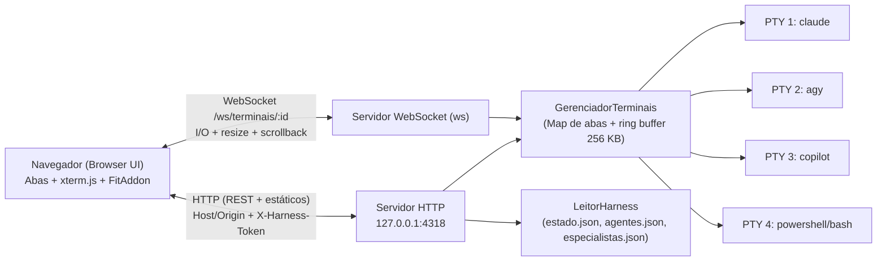

# Plano: Interface de Terminais do Harness (`harness-ui`)

- **Spec:** `specs/harness-ui/spec.md` · **Status:** aprovado pelo escopo definido em 2026-11-25

## Verificação da constituição
| Artigo | Como o plano cumpre | Risco |
|---|---|---|
| Art. I (SDD) | `spec.md`, `plan.md`, `tasks.md` e `matriz.md` criados antes do código em `specs/harness-ui/` | Baixo |
| Art. II (Testes primeiro) | Testes unitários em `apps/harness-ui/test/` com `node:test` escritos antes da implementação de cada módulo | Baixo |
| Art. IV (Segurança por padrão) | Bind em `127.0.0.1`, validação de `Host` e `Origin`, token efêmero por execução, CSP restrita sem CDN externa, allowlist de perfis e arquivos estáticos | Médio (terminal local exige proteção estrita contra CSWSH/CSRF — mitigado por Origin + token efêmero) |
| Art. V (Custo consciente) | 100% local, US$ 0,00 de nuvem | Nenhum |
| Art. VI (Operação) | Reconexão sem matar PTYs, limite de buffer (256 KB/aba), shutdown limpo em `SIGINT`/`SIGTERM` | Baixo |
| Art. VII (Privacidade) | Sem persistência de transcrições ou tokens em disco; sem links de sessão | Nenhum |

## Arquitetura

### Componentes em `apps/harness-ui/`
- `bin/pos-harness-ui.js`: ponto de entrada CLI (`--porta`, `--host`, `--raiz`), sobe o servidor e encerra PTYs com segurança em `SIGINT`/`SIGTERM`.
- `src/perfis.js`: catálogo fechado de perfis (`claude-code`, `antigravity`, `copilot`, `shell`), resolução segura do executável no PATH (Windows e POSIX) e detecção de disponibilidade.
- `src/harness.js`: leitura somente-leitura de `harness/estado.json`, `harness/agentes.json` e `harness/especialistas.json`, mais geração de prompt de passagem compatível com `harness/agente.py`.
- `src/gerenciador.js`: ciclo de vida das abas PTY (`criar`, `listar`, `obter`, `escrever`, `redimensionar`, `fechar`, `fecharTodos`), ring buffer de 256 KB por aba, eventos de saída/status e injeção de `ptyFactory`.
- `src/servidor.js`: servidor HTTP + WebSocket com proteção contra DNS rebinding (`Host`), proteção contra CSWSH (`Origin` + token efêmero), CSP restrita, serving de `@xterm/xterm` e `@xterm/addon-fit` direto de `node_modules` (lista fixa) e API REST (`/healthz`, `/api/bootstrap`, `/api/harness`, `/api/perfis`, `/api/terminais`).
- `public/index.html`, `public/styles.css`, `public/app.js`: interface escura estilo navegador com barra de abas superior (indicador de status, badge de saída não lida, fechar aba, botão `+`), painel de lançamento rápido (agente + projeto + pasta + prompt opcional), barra de status do harness e terminais `xterm.js` responsivos.

## Decisões técnicas (ADRs)
- **ADR-0001 (Dependências npm mínimas para PTY e terminal no navegador):**
  - **Contexto:** `node:child_process` sem PTY não suporta TUIs interativas (`claude`, `agy`, `copilot`, cores ANSI, cursor, resize).
  - **Decisão:** usar apenas 4 dependências diretas em `apps/harness-ui/package.json`: `node-pty` (ConPTY no Windows / PTY em POSIX), `ws` (WebSocket server), `@xterm/xterm` e `@xterm/addon-fit` (emulador de terminal no browser servido localmente, sem CDN).
  - **Alternativas rejeitadas:** Electron/Tauri (peso excessivo de build), `wt.exe` externo (abas fora da interface web), `child_process` puro (quebra TUIs de code agents).
  - **Trade-off:** `node-pty` usa binário nativo (pré-compilado para Node 22/Windows na versão 1.x) e fica isolado em `apps/harness-ui/`, preservando `apps/painel-ia/` com zero dependências.

## Estratégia de testes
- **Unitários (`node --test "test/**/*.test.js"`):**
  - `test/perfis.test.js`: resolução de perfis, allowlist, detecção de binários e rejeição de perfil desconhecido.
  - `test/gerenciador.test.js`: criação de múltiplas abas independentes, escrita, resize, ring buffer truncado em 256 KB, encerramento individual sem afetar outras abas, encerramento total.
  - `test/harness.test.js`: leitura do estado SDD, projetos e perfis de agentes.
  - `test/servidor.test.js`: headers de segurança (CSP, nosniff, frame-options), bloqueio de `Host` inválido, bloqueio de `Origin` externo, exigência de token efêmero em `POST`/`DELETE` e WebSocket, fluxo completo HTTP + WebSocket com `ptyFactory` mockado.
- **Matriz regra → teste:** `specs/harness-ui/matriz.md`.

## Custo do lab
- **Teto diário:** US$ 0,00 (ferramenta estritamente local).
